# PocketDSO — Touchscreen Pocket Oscilloscope & Spectrum Analyzer

[](LICENSE)
[](https://docs.waveshare.com/ESP32-C6-Touch-LCD-1.47)
[](https://docs.waveshare.com/ESP32-C6-Touch-LCD-1.47)
[](#7-web-ui-remote-control--rest-api)

> **PocketDSO** is a finger-friendly, dual-channel Digital Storage Oscilloscope (DSO), Mixed-Signal Logic Analyzer, and 128-bin FFT Frequency Spectrum Analyzer running on the **[Waveshare ESP32‑C6‑Touch‑LCD‑1.47‑M](https://docs.waveshare.com/ESP32-C6-Touch-LCD-1.47)** (1.47" 172×320 IPS capacitive touchscreen). It features on-device touch controls, a built-in calibration signal generator, battery monitoring, and an asynchronous Wi-Fi Web UI with 25+ FPS WebSocket streaming, interactive measurement cursors, and 1-click CSV export.

---

> [!CAUTION]
> ### Disclaimer & Operational Notice
> **PocketDSO is strictly a hobbyist, educational, and experimental development tool.**  
> It must **never** be used for critical engineering, medical, life-support, industrial safety, or mains-voltage decisions.  
> All calculated values (DC voltages, true AC RMS ripple, peak-to-peak amplitude, and frequency) depend directly on the physical characteristics and tolerances of your hardware (ESP32-C6 SAR ADC linearity, resistor divider tolerances, jumper wire inductance, and breadboard parasitics). Software calibration and conditioning **cannot** compensate for physical hardware noise floors or component inaccuracies. Use entirely at your own risk.  
> 👉 **Read the full [DISCLAIMER.md](DISCLAIMER.md) before connecting any signals.**

---

## 📸 Real Hardware in Action

Here is PocketDSO running on the physical **Waveshare ESP32-C6-Touch-LCD-1.47-M** development board:

| Dual-Channel Signal Waveform | 128-Bin FFT Spectrum Analyzer |
|:---:|:---:|
|  |  |
| *Dual-channel capture ($50\text{ Hz}$ sine wave, $1.73\text{ V}$, $5\text{ ms/div}$, $2\text{ V/div}$)* | *Real-time 128-bin FFT histogram locking onto fundamental peak at $49.4\text{ Hz}$* |

| Scope Configuration Menu | System Diagnostics & Settings | Idle Scope Baseline |
|:---:|:---:|:---:|
|  |  |  |
| *`[SCOPE]` tab: Auto Timebase, Auto Volts, Sample Rate & Probes* | *`[SYS]` tab: Battery SoC, Uptime, Brightness, Firmware & MCU info* | *Clean baseline reticle with top telemetry and touch controls* |

---

## 1. Key Features

- **Hardware Platform**: Built specifically for the **[Waveshare ESP32‑C6‑Touch‑LCD‑1.47‑M](https://docs.waveshare.com/ESP32-C6-Touch-LCD-1.47)** (RISC-V 160 MHz, 512 KB SRAM, 8 MB Flash).
- **Dual-Channel Architecture**:
  - **Probe A (CH1)**: Optimized for sub-$5.5\text{ V}$ signals with default **$2\times$ Divider ($0 \dots 6.6\text{ V}$)** yielding **$1.6\text{ mV}$ LSB resolution** (ideal for 3.3V/5V logic and low-voltage ripple).
  - **Probe B (CH2)**: Safe for $12\text{ V}$ power supplies with default **$4\times$ Divider ($0 \dots 13.2\text{ V}$)** yielding **$3.2\text{ mV}$ LSB resolution** (or digital logic analyzer `[D1]`).
- **Touchscreen Ergonomics**:
  - Oversized $74 \times 34\text{ px}$ tactile buttons along the bottom edge for easy thumb tapping.
  - Direct vertical finger-drag anywhere inside the waveform area to position the trigger threshold ($T$) smoothly.
  - One-tap top bar badge `[FFT]` switches instantly between time-domain scope and frequency spectrum analyzer.
- **Standalone FFT Spectrum Analyzer**:
  - 256-point Cooley-Tukey Radix-2 FFT with Hann windowing for minimal spectral leakage.
  - Electric blue gradient histogram with pill-shaped rounded caps and automated peak frequency marker (`PEAK xx.x Hz`).
  - Selectable horizontal zoom (`AUTO` peak-fit, `FULL` 0..Nyquist, `2x`, `4x`, `8x`) and vertical magnitude scale (Logarithmic $\text{dB}$ or Linear).
- **Built-in Calibration Signal Generator**:
  - Dedicated square-wave output on **`GPIO7`** selectable between `1 kHz`, `10 kHz`, `50 kHz`, or `OFF` ($3.3\text{ Vpp}$).
  - Zero-wire internal loopback self-test mode for instant diagnostics without any jumper wires.
- **Responsive Wi-Fi Web UI**:
  - Non-blocking boot sequence (boots standalone in 8 seconds if Wi-Fi is offline).
  - 25+ FPS real-time WebSocket push stream (`/ws`) with CRT phosphor glow canvas.
  - Interactive draggable time ($X_1, X_2 \rightarrow \Delta T, f$) and voltage ($Y_1, Y_2 \rightarrow \Delta V$) cursors.
  - 1-Click CSV export of 320-point capture buffers directly to PC or phone.
  - Complete REST API for automated telemetry extraction and remote parameter tuning.

---

## 2. Hardware Architecture & Pin Mapping

On the Waveshare board, several ESP32-C6 pins are routed internally to display and touch peripherals. PocketDSO uses dedicated, conflict-free pins for all external connections:

| Pin | Subsystem | Function | Signal Specification |
|:---|:---|:---|:---|
| **`GPIO6`** | **Probe A (CH1)** | Analog Input 1 (`ADC1_CH6`) | $0 \dots 6.6\text{ V}$ with $2\times$ divider ($1.6\text{ mV}$ resolution) |
| **`GPIO5`** | **Probe B (CH2)** | Analog Input 2 (`ADC1_CH5`) or Digital D1 | $0 \dots 13.2\text{ V}$ with $4\times$ divider ($3.2\text{ mV}$ resolution) |
| **`GPIO7`** | **Cal Out** | Built-in Test Signal Generator | $3.3\text{ Vpp}$ square wave (`1 kHz`, `10 kHz`, `50 kHz`) |
| **`GPIO0`** | **Battery Monitor** | Onboard Factory 3:1 Divider (`BAT_ADC`) | $3.3 \dots 4.2\text{ V}$ LiPo battery level and USB detection |
| **`GPIO1`** | Internal | `LCD_SCK` (SPI Clock) | **Do not connect externally** (driven at 40 MHz) |
| **`GPIO2`** | Internal | `LCD_MOSI` (SPI Data) | **Do not connect externally** |
| **`GPIO14`** | Internal | `LCD_CS` (Chip Select) | Hardware SPI control |
| **`GPIO15`** | Internal | `LCD_DC` (Data/Command) | Hardware SPI control |
| **`GPIO22`** | Internal | `LCD_RST` (LCD Reset) | Hardware display reset |
| **`GPIO23`** | Internal | `LCD_BL` (Backlight PWM) | 4-step brightness control ($15\%, 40\%, 70\%, 100\%$) |
| **`GPIO4`** | Internal | `TF_CS` (TF Card Chip Select) | Pulled `HIGH` on boot to prevent SPI bus conflict |
| **`GPIO18`** | Internal | `TOUCH_SDA` (I²C Data) | `AXS5106L` capacitive touch controller (`0x63`) |
| **`GPIO19`** | Internal | `TOUCH_SCL` (I²C Clock) | `AXS5106L` capacitive touch controller (`0x63`) |
| **`GPIO20`** | Internal | `TOUCH_RST` (Touch Reset) | Touch reset line |
| **`GPIO21`** | Internal | `TOUCH_INT` (Touch Interrupt) | Touch interrupt line |

---

## 3. Wiring Diagram & Electronics Bill of Materials (BOM)

To build the dual-channel probes safely and accurately, refer to the electronics schematic below:


### 3.1 Required Components List

| Qty | Component | Value / Rating | Role in Circuit | Status |
|:---:|:---|:---|:---|:---:|
| **1×** | **Waveshare ESP32‑C6‑Touch‑LCD‑1.47‑M** | Waveshare SKU 31201 | MCU + 1.47" IPS LCD + Touch + Battery Charger | **Required** |
| **6×** | **Divider Resistors** | **$10\text{ k}\Omega$**, ¼ W (1% metal-film) | $2\times$ divider on CH1 ($2\times 10\text{ k}\Omega$), $4\times$ divider on CH2 ($3\times 10\text{ k}\Omega$ series $+ 1\times 10\text{ k}\Omega$) | **Required** |
| **2×** | **Protection Resistors ($R_1$)** | **$1\text{ k}\Omega$**, ¼ W (1%) | Current limiting into `GPIO6` (CH1) and `GPIO5` (CH2) | **Mandatory** |
| **2×** | **Filter Resistors ($R_4$)** | **$100\ \Omega$**, ¼ W | Anti-ringing RC filter resistor ($f_c \approx 16\text{ MHz}$) | Optional |
| **2×** | **Filter Capacitors ($C_1$)** | **$100\text{ pF}$** ceramic (50V) | Anti-aliasing / ringing damping capacitor to GND | Optional |
| **1 pk** | **DuPont Jumper Wires** | Female-to-Female & Female-to-Male | Board header to breadboard wiring | **Required** |
| **2×** | **Alligator Grabber Leads** | Mini IC grabber clips | Signal and Ground circuit connections | Recommended |
| **1×** | **Mini Breadboard** | 170-point or 400-point | Mounting the resistor divider network | Recommended |
| **1×** | **USB Type-C Cable** | Data + Power | Firmware upload and 5V power supply | **Required** |
| **1×** | **$3.7\text{ V}$ LiPo Battery** | 500–1000 mAh with **MX1.25 2-pin connector** | Cordless pocket instrument operation | Optional |

### 3.2 Probe Circuit Schematics

#### Probe A (CH1) — High-Accuracy $2\times$ Divider ($0 \dots 6.6\text{ V}$)
```text
  [Probe A Tip] ─── [R2: 10 kΩ] ───┬─── [R1: 1 kΩ] ───┬─── [R4: 100 Ω] ───► GPIO6 (ADC1_CH6 / CH1)
                                   │                  │
                            [R3: 10 kΩ]          [C1: 100 pF] (Optional RC filter)
                                   │                  │
  [GND Clip]    ───────────────────┴──────────────────┴───────────────────► GND   (Board Ground)
```

#### Probe B (CH2) — 12V Power Rails $4\times$ Divider ($0 \dots 13.2\text{ V}$)
```text
  [Probe B Tip] ── [R2: 30 kΩ (three 10 kΩ in series)] ──┬── [R1: 1 kΩ] ──┬── [R4: 100 Ω] ──► GPIO5 (ADC1_CH5 / CH2)
                                                         │                │
                                                   [R3: 10 kΩ]       [C1: 100 pF] (Optional RC filter)
                                                         │                │
  [GND Clip]    ─────────────────────────────────────────┴────────────────┴─────────────────► GND   (Board Ground)
```

---

## 4. UI Geometry & Ergonomic Layout


Operating an oscilloscope on a **1.47‑inch screen** (`320 × 172 px` active area, $\approx 35 \times 19\text{ mm}$) requires ergonomic layout design:
1. **Top Telemetry Bar (`320 × 24 px`)**:
   - `[AUTO]` / `[A_T]` / `[A_V]` / `[MAN]` badge: Displays and toggles automatic horizontal and vertical signal prescaling.
   - Numerical Readouts: Average DC voltage ($V_{\text{DC}}$), True AC RMS ripple ($V_{\text{RMS,AC}} = \sqrt{\frac{1}{N}\sum(v_i - V_{\text{DC}})^2}$), Peak-to-Peak ($V_{\text{pp}}$), and Fundamental Frequency (`Hz`/`kHz`).
   - `[FFT]` button: One-tap toggle to jump to the standalone 1024-point FFT frequency spectrum analyzer.
   - **Battery & USB Power Meter**: Automatic detection of USB power (`⚡ USB` when running without a battery, or full battery with a lightning bolt when charging/full on USB) vs LiPo battery gauge ($0 \dots 100\%$ with green/yellow/red color thresholds). Tapping the icon immediately opens the `[SYS]` power diagnostics tab.
   - Wi-Fi signal indicator: 4-bar RSSI gauge (tapping opens network diagnostics).
   - `[⚙ MENU]` button: Opens the full-screen 5-tab settings modal with instant touch response.
2. **Waveform Reticle & Touch Trigger (`320 × 110 px`)**:
   - Standard $10 \times 6$ grid divisions with sub-division tick marks along the center axes.
   - Direct Touch-Drag: Slide your thumb vertically on the grid to position the magenta trigger threshold line ($T$).
3. **Bottom Control Bar (`320 × 38 px`)**:
   - Four oversized rounded buttons ($74 \times 34\text{ px}$): `AUTO SCALE`, `T / div`, `V / div`, and `> RUN` / `|| HOLD`.
4. **Zero-Latency Navigation & Instant "DONE" Return**:
   - Expanded top-right touch zone ($x \ge 240, y \le 32\text{ px}$) ensures every tap on `DONE` reliably triggers `ACT_CLOSE_MENU`.
   - Direct frame switching immediately renders the scope view ($\approx 35\text{ ms}$ response) without blocking on ADC sampling bursts or unnecessary NVS flash writes.

---

## 5. Software Screen Reference Gallery

All screenshots below are lossless pixel-accurate digital captures taken directly from the physical **Waveshare ESP32-C6-Touch-LCD-1.47-M** device over Wi-Fi via `screenshot.js`:

### 5.1 Main Oscilloscope Views

| Live Scope Trace (`01_scope_main.png`) | Partial Auto Timebase Mode (`12_badge_A_T.png`) |
|:---:|:---:|
|  |  |
| *Active 1 kHz calibration wave with DC/RMS telemetry, FFT button, battery, Wi-Fi, and MENU* | *Independent Auto-Timebase badge (`A_T`) with manual voltage scale locked* |

| Bottom Master AUTO (`13_bottom_auto.png`) | Waveform Freeze / HOLD (`14_run_hold.png`) |
|:---:|:---:|
| 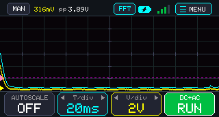 | 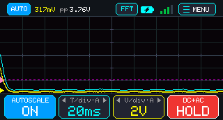 |
| *Bottom tactile button triggering automated timebase & voltage scaling* | *Red `[HOLD]` state freezing acquisition buffer for detailed inspection* |

### 5.2 Settings Modal Tabs

| Tab 1: Scope Settings (`02_menu_scope_tab.png`) | Tab 2: Trigger Settings (`03_tab_trig.png`) |
|:---:|:---:|
|  | 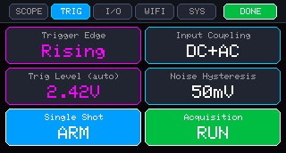 |
| *Auto T/V toggles, Timebase, Volts/div, Sample Rate, and Probe A/B scaling* | *Trigger slope (Rising/Falling), AC Coupling, Level, Hysteresis, and Single Arm* |

| Tab 3: I/O & Cal Generator (`03_tab_io.png`) | Tab 4: Wi-Fi Diagnostics (`03_tab_wifi.png`) |
|:---:|:---:|
| 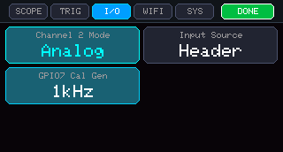 | 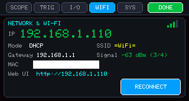 |
| *CH2 Mode (Analog/Digital/OFF), Signal Source (Probes vs 0-Wire Loopback), and Cal Gen* | *Connected IP, SSID, RSSI dBm signal strength, Gateway, MAC & Reconnect button* |

| Tab 5: Power & System (`03_tab_sys.png`) | Finalized Baseline Screen (`15_final.png`) |
|:---:|:---:|
| 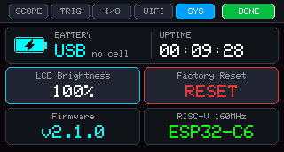 | 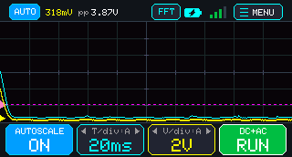 |
| *Live battery gauge, voltage, uptime counter, LCD backlight brightness, and factory reset* | *Return to main scope view with active telemetry and zero-latency transition* |

### 5.3 FFT Frequency Spectrum Analyzer

| Dedicated FFT Spectrum (`05_fft.png`) | FFT Auto-Zoom Mode (`06_fft_zoom.png`) |
|:---:|:---:|
| 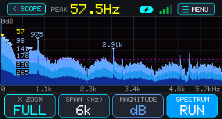 | 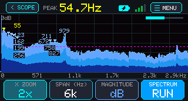 |
| *1024-point FFT with automated fundamental peak frequency lock (`PEAK 1.00kHz`)* | *Auto-Zoom centered dynamically around dominant spectral harmonics* |

| FFT Nyquist Span Select (`07_fft_span.png`) | FFT Linear Magnitude Scale (`08_fft_linear.png`) |
|:---:|:---:|
| 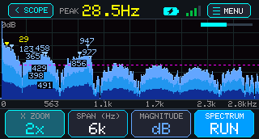 | 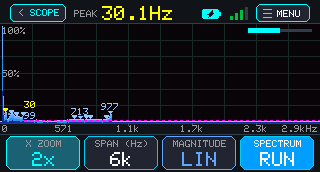 |
| *Selectable frequency span ($0 \dots 75\text{ kHz}$) and horizontal bin resolution* | *Linear magnitude mode displaying raw proportional voltage amplitude per bin* |

---

## 6. Installation & Firmware Flashing

### Option A: Using PlatformIO (Recommended One-Click CLI)

PocketDSO comes configured with a ready-to-use [`platformio.ini`](platformio.ini) pointing to the firmware inside `oscilloscope/`.

1. Install **[VS Code](https://code.visualstudio.com/)** and the **[PlatformIO IDE extension](https://platformio.org/install/ide?install=vscode)** (or use PlatformIO Core CLI).
2. Clone this repository and open the workspace folder:
   ```bash
   git clone https://github.com/MoisisV/PocketDSO.git
   cd PocketDSO
   ```
3. Connect the Waveshare ESP32-C6 board to your computer via USB-C.
4. Build and flash the firmware:
   ```bash
   pio run -t upload
   ```
5. Open the Serial Monitor at 115200 baud to view network connection logs:
   ```bash
   pio device monitor -b 115200
   ```

> [!TIP]
> **Bootloader Recovery**: If the board does not automatically reset into flashing mode:
> 1. Press and hold the onboard **`BOOT`** button.
> 2. Press and release the **`RESET`** button once.
> 3. Release the **`BOOT`** button.
> 4. Run `pio run -t upload`. Once flashing completes, press **`RESET`** to boot PocketDSO.

---

### Option B: Using Arduino IDE (GUI)

1. Download and install **[Arduino IDE 2.3+](https://www.arduino.cc/en/software)**.
2. In **Settings / Preferences $\rightarrow$ Additional Boards Manager URLs**, paste:
   ```text
   https://espressif.github.io/arduino-esp32/package_esp32_index.json
   ```
3. Open **Boards Manager**, search for **`esp32`**, and install **`esp32` by Espressif Systems** (version **`3.0.5`** or newer).
4. Open **Library Manager** and install:
   - **`GFX Library for Arduino`** (by **Moon On Our Nation**, version **1.4.9** or newer).
   - *(Optional for Web UI)* **`ESP Async WebServer`** (by mathieucarbou) and **`AsyncTCP`**.
5. Configure the **Tools** menu settings:
   - **Board**: `ESP32 Arduino` $\rightarrow$ **`ESP32C6 Dev Module`**
   - **USB CDC On Boot**: **`Enabled`** *(Mandatory for Serial logs over USB-C)*
   - **Flash Size**: **`8MB (64Mb)`**
   - **Partition Scheme**: **`8M with spiffs (3MB APP/1.5MB SPIFFS)`** or **`Huge APP`**
   - **Upload Speed**: **`921600`**
6. Open [`oscilloscope/wifi_config.h`](oscilloscope/wifi_config.h) to configure your Wi-Fi SSID and password (or leave the defaults to boot in standalone offline mode).
7. Open [`oscilloscope/oscilloscope.ino`](oscilloscope/oscilloscope.ino) and click **Upload (`→`)**.

---

### Option C: Using Docker (Zero-Install Firmware Build)

If you do not want to install PlatformIO or Arduino IDE locally, you can compile the firmware and generate a single merged flashable image inside Docker using [`Dockerfile`](Dockerfile), [`docker-compose.yml`](docker-compose.yml), and [`docker-entrypoint.sh`](docker-entrypoint.sh):

1. *(Optional)* Open [`oscilloscope/wifi_config.h`](oscilloscope/wifi_config.h) to set your Wi-Fi SSID and password before building.
2. Build the firmware and merge the bootloader, partition table (`default_8MB.csv`), and application binary:
   ```bash
   docker compose up --build
   ```
3. Once complete, the unified flashable binary is written to:
   - `firmware/firmware-merged.bin` *(single-file image flashed at offset `0x0`, configured for 8MB flash)*
   - Component binaries remain in `.pio/build/esp32-c6-devkitm-1/`
4. Rebuilds reuse the `pio_cache` Docker volume for fast incremental compilation. To clean build artifacts:
   ```bash
   docker compose run --rm builder clean
   ```

---

### Option D: Browser Flashing with ESPHome Web (`web.esphome.io`)

You can flash `firmware/firmware-merged.bin` (from Option C, or a prebuilt merged release binary) directly from your browser without installing any flashing tools:

1. Open **[https://web.esphome.io/](https://web.esphome.io/)** in **Google Chrome** or **Microsoft Edge** *(Web Serial API required)*.
2. Connect the **Waveshare ESP32-C6-Touch-LCD-1.47-M** to your computer using a data-capable USB-C cable.
3. Click **Connect** and select your board's serial port (for example `COM*` on Windows or `/dev/cu.usbmodem*` / `/dev/ttyACM*` on macOS/Linux).
4. Click **Install**, select **`firmware/firmware-merged.bin`**, and confirm to flash the unified image starting at offset `0x0`.
5. Once flashing finishes, press the onboard **`RESET`** button if the board does not reboot automatically.

> [!TIP]
> **CLI Alternative**: If you prefer flashing the unified binary with `esptool` from a terminal, write it to offset `0x0`:
> ```bash
> esptool --chip esp32c6 write_flash 0x0 firmware/firmware-merged.bin
> ```
> If the board does not enter download mode automatically, hold **`BOOT`**, tap **`RESET`**, and release **`BOOT`** before clicking **Connect** or running `esptool`.

---

## 7. Web UI Remote Control & Real-Time Browser Dashboard

PocketDSO includes a fully self-contained, high-performance Web Application served directly from the ESP32-C6 Flash memory (`PROGMEM`). You do **not** need an internet connection, Node.js, or external cloud servers—the ESP32 acts as an embedded web server running right on your local Wi-Fi network.


### 7.1 How to Connect & Open the Web UI

1. **Set your Wi-Fi Credentials**:
   Open [`oscilloscope/wifi_config.h`](oscilloscope/wifi_config.h) and enter your local Wi-Fi SSID and password:
   ```cpp
   #define WIFI_SSID     "YourNetworkName"
   #define WIFI_PASSWORD "YourSecretPassword"
   ```
   *(If left as `"WIFI_SSID"`, PocketDSO starts in standalone offline mode with zero delay).*

2. **Power On & Obtain IP Address**:
   - On boot, the ESP32-C6 connects to your Wi-Fi network within 3–5 seconds.
   - An **8-second non-blocking safety timeout** ensures that if Wi-Fi is disconnected or out of range, the physical LCD display boots immediately into standalone mode without hanging.
   - Once connected, the assigned IP address is clearly shown on the physical LCD screen (and in the `[WIFI]` settings tab).

3. **Open the Dashboard in your Browser**:
   Open any modern web browser on your computer, tablet, or smartphone (Chrome, Safari, Firefox, Edge) and navigate to:
   ```text
   http://<ESP32_IP_ADDRESS>
   ```
   Or on devices that support mDNS / Bonjour (macOS, iOS, Windows, Linux):
   ```text
   http://pocketdso.local
   ```

---

### 7.2 Web UI Features & How to Handle the Device

The Web UI transforms your computer or tablet into a full-size lab oscilloscope display while keeping bidirectional sync with the physical ESP32 device:

1. **Live High-FPS Waveform Display**:
   - **HTML5 `<canvas>` with CRT Phosphor Glow**: Renders dual analog traces (CH1 in neon yellow, CH2 in cyan) and the digital logic analyzer lane (`[D1]` in mint green) at 25+ FPS.
   - **Real-Time Telemetry Cards**: Live readouts display **CH1 DC Mean**, **CH1 AC RMS**, **CH1 Peak-to-Peak ($V_{\text{pp}}$)**, **Frequency (Hz)**, **Timebase**, **Volts/div**, **Trigger Voltage**, and **Achieved Sample Rate ($f_s$)**.

2. **Full Remote Control & Device Handling**:
   - **`▶ RUN` / `⏸ HOLD`**: Instantly freeze waveform acquisition from your browser to inspect transient glitches.
   - **`⚡ AUTO` Scale**: Triggers automated signal prescaling for both voltage and timebase.
   - **Horizontal & Vertical Controls**: Change horizontal Timebase ($20\,\mu\text{s/div} \dots 50\,\text{ms/div}$) and vertical Volts/div ($0.1\text{ V/div} \dots 2.0\text{ V/div}$) directly using on-screen buttons and drop-down selectors.
   - **Trigger Controls**: Switch trigger slopes (`Rising Edge /`, `Falling Edge \`, `Free Run`, `Single Shot !`), adjust trigger hysteresis, and click-drag the magenta trigger indicator (`T`) on the canvas.
   - **Channel 2 Mode**: Switch between `Analog CH2`, `Digital Logic D1`, or `OFF`.
   - **Calibration Generator**: Toggle the onboard square-wave generator on `GPIO7` (`1 kHz`, `10 kHz`, `50 kHz`, or `OFF`).
   - **Zero-Wire Loopback**: Toggle the internal software signal generator for testing without physical probes.

3. **Interactive On-Screen Measurement Cursors (`📏 Cursors: ON`)**:
   - Tap **`Cursors: ON`** to overlay interactive time and voltage crosshairs on the graph:
     - **Time Cursors ($X_1, X_2$)**: Drag the blue and orange vertical lines to measure time intervals ($\Delta T$) and automatically calculate frequency ($f = \frac{1}{\Delta T}$).
     - **Voltage Cursors ($Y_1, Y_2$)**: Drag the green and purple horizontal lines to measure differential voltage ($\Delta V$).

4. **In-Browser FFT Spectrum Analyzer (`📊 FFT: ON`)**:
   - Tap **`FFT: ON`** to open an integrated 128-bin frequency spectrum analyzer below the main time-domain waveform.
   - Automatically tracks dominant harmonic peaks and fundamental frequencies in real time.

5. **1-Click Raw CSV Data Export (`📥 CSV`)**:
   - Click the **`📥 CSV`** button in the top navigation bar to download all 320 capture data points directly to your computer as a `.csv` spreadsheet file (time in microseconds, CH1 voltage, CH2 voltage).
   - No Python scripts or terminal commands required!

6. **1-Click High-Res PNG Capture (`📷 Capture`)**:
   - Click **`📷 Capture`** to save an instant PNG screenshot of the live scope graph complete with reticle, traces, and timestamp.

7. **Wi-Fi Diagnostics Modal (`⚙ Wi-Fi`)**:
   - Click the Wi-Fi badge to open a live diagnostics popup displaying RSSI signal strength ($\text{dBm}$), Gateway, Subnet, MAC address, and active WebSocket client count.

---

### 7.3 Machine-to-Machine & LLM Agent HTTP REST API

PocketDSO exposes a complete REST API over HTTP, allowing external scripts, automated CI/CD hardware-in-the-loop runners, and **autonomous AI/LLM coding agents** (e.g., Claude Code, Gemini CLI, Antigravity, OpenAI Assistants) to fully monitor, measure, diagnose, tune, and visually verify the physical instrument over local Wi-Fi.

#### 7.3.1 API Endpoint Summary

| Endpoint | Method | Response | Description |
|:---|:---:|:---:|:---|
| `/` or `/index.html` | `GET` | `text/html` | Embedded HTML5/Canvas oscilloscope web application |
| `/api/metrics` | `GET` | `application/json` | Real-time measurement telemetry, frequency, voltages, battery, and network stats |
| `/api/state` | `GET` | `application/json` | Complete machine-readable settings snapshot (all indices, flags, and actual $f_s$) |
| `/api/waveform` | `GET` | `application/json` | 320-point CH1/CH2 downsampled display trace coordinates and trigger level |
| `/api/fft` | `GET` | `application/json` | 1024-point FFT spectrum analysis, peak frequency, magnitude, and detected harmonic peaks |
| `/api/set` | `GET` / `POST` | `text/plain` | Dynamic parameter modification engine (accepts multi-parameter queries) |
| `/api/tap` | `GET` | `application/json` | Programmatic touchscreen emulation in landscape space (`?x=...&y=...`) |
| `/api/screenshot` | `GET` | `application/octet-stream` | Raw binary framebuffer stream (`DSOS` format) decoded by `screenshot.js` into lossless PNG |
| `/api/save` | `GET` | `text/plain` | Forces immediate NVS flash commit of current settings |
| `/api/reboot` | `GET` | `text/plain` | Remote MCU restart (`?save=1` to commit settings first) |

---

#### 7.3.2 Real-Time Telemetry: `GET /api/metrics`

Returns live telemetry for automated monitoring and LLM observation:

```bash
curl -s http://pocketdso.local/api/metrics | jq
```

```json
{
  "dc": 1.65,
  "ac": 1.65,
  "vpp": 3.30,
  "freq": 1000.0,
  "duty": 50.0,
  "fs": 200000,
  "timeBaseIdx": 3,
  "timeBaseStr": "200us",
  "vDivIdx": 3,
  "vDivStr": "1V",
  "autoT": 1,
  "autoV": 1,
  "running": 1,
  "acCoupled": 0,
  "ch2Mode": 1,
  "probeIdx": 1,
  "probeBIdx": 2,
  "selfTest": 0,
  "trigMode": 0,
  "trigVolts": 1.65,
  "calFreqIdx": 1,
  "batVolts": 4.18,
  "batPct": 100,
  "ip": "192.168.1.142",
  "ssid": "HomeLab_WiFi",
  "rssi": -55,
  "bars": 4,
  "gw": "192.168.1.1",
  "mac": "24:EC:4A:12:34:56",
  "clients": 1,
  "httpReqs": 142,
  "ch2dc": 0.000,
  "ch2ac": 0.000,
  "ch2vpp": 0.000,
  "ch2freq": 0.0
}
```

*Note: `ch2dc`, `ch2ac`, `ch2vpp`, and `ch2freq` report `0` when `ch2Mode == 0` (OFF).*

---

#### 7.3.3 Full Configuration State Snapshot: `GET /api/state`

Provides an LLM agent with an unambiguous state vector for deterministic test verification:

```bash
curl -s http://pocketdso.local/api/state | jq
```

```json
{
  "fw": "2.0",
  "trigVolts": 1.650,
  "timeBaseIdx": 3,
  "vDivIdx": 3,
  "sampleRateIdx": 3,
  "probeIdx": 1,
  "probeBIdx": 2,
  "calFreqIdx": 1,
  "ch2Mode": 1,
  "trigMode": 0,
  "hystIdx": 1,
  "brightnessIdx": 3,
  "fftSpanIdx": 1,
  "fftLogScale": 1,
  "fftZoomIdx": 0,
  "autoTimebase": 1,
  "autoVolts": 1,
  "acCoupled": 0,
  "selfTest": 0,
  "userSetTrig": 0,
  "actualFs": 198412,
  "captureSamples": 1024
}
```

---

#### 7.3.4 FFT Frequency Spectrum Analysis: `GET /api/fft`

Returns the 1024-point FFT spectrum and automated harmonic peaks:

```bash
curl -s http://pocketdso.local/api/fft | jq
```

```json
{
  "peakFreq": 1000.0,
  "peakMag": 0.9850,
  "binHz": 48.828,
  "fs": 200000,
  "thr": 10,
  "zoom": 0,
  "f0": 0.0,
  "f1": 25000.0,
  "peaks": [
    { "f": 1000.0, "m": 1000, "i": 20 },
    { "f": 3000.0, "m": 332, "i": 61 },
    { "f": 5000.0, "m": 198, "i": 102 }
  ],
  "bins": [ 0, 12, 45, 1000, 52 ]
}
```

---

#### 7.3.5 Remote Parameter Tuning Engine: `GET|POST /api/set`

Change any instrument setting dynamically via query parameters:

```bash
# Enable loopback calibrator, rising trigger, auto-scaling:
curl -s "http://pocketdso.local/api/set?selfTest=1&calFreqIdx=1&trigMode=0&auto=1"

# Set manual 100 µs/div, 0.5 V/div, AC coupling:
curl -s "http://pocketdso.local/api/set?timeBaseIdx=2&vDivIdx=2&acCoupled=1"
```

| Parameter | Type / Range | Description |
|:---|:---:|:---|
| `running` | `0` or `1` / `bool` | `0` = Freeze acquisition (`HOLD`), `1` = Live acquisition (`RUN`) |
| `auto` / `autoset` | `0` or `1` / `bool` | Triggers master auto-prescaling for both timebase and voltage |
| `autoT` / `autoTimebase`| `0` or `1` / `bool` | Enables/disables independent automatic horizontal timebase selection |
| `autoV` / `autoVolts` | `0` or `1` / `bool` | Enables/disables independent automatic vertical voltage scale selection |
| `timeBaseIdx` | `0 .. 10` | `0`: 20µs, `1`: 50µs, `2`: 100µs, `3`: 200µs, `4`: 500µs, `5`: 1ms, `6`: 2ms, `7`: 5ms, `8`: 10ms, `9`: 20ms, `10`: 50ms/div |
| `vDivIdx` | `0 .. 6` | `0`: 0.1V, `1`: 0.2V, `2`: 0.5V, `3`: 1V, `4`: 2V, `5`: 5V, `6`: 10V/div |
| `probeIdx` | `0 .. 3` | Channel 1 probe attenuation: `0`: 1x (3.3V), `1`: 2x (6.6V), `2`: 4x (13.2V), `3`: 10x (33V) |
| `probeBIdx` | `0 .. 3` | Channel 2 probe attenuation: `0`: 1x, `1`: 2x, `2`: 4x, `3`: 10x |
| `ch2Mode` | `0 .. 2` | Channel 2 operation: `0`: OFF, `1`: Analog CH2, `2`: Digital Logic Analyzer (`[D1]`) |
| `acCoupled` | `0` or `1` / `bool` | `0`: DC + AC coupling, `1`: AC-only coupling (strips DC offset) |
| `trigMode` | `0 .. 3` | `0`: Rising Edge (`^`), `1`: Falling Edge (`v`), `2`: Free Run, `3`: Single Shot (`!`) |
| `trigVolts` | `float` | Exact trigger voltage threshold in volts (e.g. `1.65`) |
| `trigAuto` | `1` | Auto-calculates and centers the trigger threshold at the waveform DC midpoint |
| `single` | `1` | Arms the single-shot trigger engine and awaits transient edge |
| `hystIdx` | `0 .. 3` | Trigger noise hysteresis: `0`: 25mV, `1`: 50mV, `2`: 100mV, `3`: 200mV |
| `calFreqIdx` | `0 .. 3` | Onboard `GPIO7` square-wave calibration generator: `0`: OFF, `1`: 1 kHz, `2`: 10 kHz, `3`: 50 kHz |
| `selfTest` | `0` or `1` / `bool` | `0`: Normal physical probe pins (`GPIO6`/`GPIO5`), `1`: 0-Wire internal loopback generator |
| `brightness` | `0 .. 3` | LCD backlight level: `0`: 15%, `1`: 40%, `2`: 70%, `3`: 100% |
| `fftLog` | `0` or `1` / `bool` | FFT magnitude scale: `0`: Linear, `1`: Logarithmic dB |
| `fftSpan` | `0 .. 3` | FFT sampling span: `0`: 20 kS/s, `1`: 50 kS/s, `2`: 100 kS/s, `3`: 200 kS/s |
| `fftZoom` | `0 .. 4` | FFT horizontal zoom: `0`: AUTO, `1`: FULL, `2`: 2x, `3`: 4x, `4`: 8x |
| `fftThr` | `1 .. 100` | FFT harmonic peak detection threshold (% of dominant peak) |
| `reconnect` | `1` | Forces Wi-Fi subsystem to re-probe IP and reconnect |

---

#### 7.3.6 Programmatic Touchscreen Emulation: `GET /api/tap`

Allows agents and automation scripts to simulate finger touches on the physical LCD screen in landscape space ($0 \le x < 320, 0 \le y < 172$):

```bash
# Tap the MENU button (top right: x=283, y=13)
curl -s "http://pocketdso.local/api/tap?x=283&y=13"
# Response: {"ok":true,"x":283,"y":13,"act":2,"screen":1,"tab":0}

# Tap the "DONE" button to exit menu (x=280, y=16)
curl -s "http://pocketdso.local/api/tap?x=280&y=16"
# Response: {"ok":true,"x":280,"y":16,"act":4,"screen":0,"tab":0}
```

##### Key Screen Coordinates for Automation & Agents:

| Screen | Target Control | Landscape Coordinate `(X, Y)` | Dispatched Action |
|:---|:---|:---:|:---|
| **Scope** | Top `[AUTO]` Badge | `(27, 13)` | `ACT_TOGGLE_AUTO` |
| **Scope** | Top `[FFT]` Button | `(182, 13)` | `ACT_OPEN_FFT` |
| **Scope** | Top Battery / USB Icon | `(212, 13)` | `ACT_OPEN_SYS` (opens SYS tab) |
| **Scope** | Top Wi-Fi Icon | `(239, 13)` | `ACT_OPEN_NET` (opens WIFI tab) |
| **Scope** | Top `[⚙ MENU]` Button | `(283, 13)` | `ACT_OPEN_MENU` |
| **Scope** | Bottom `AUTO SCALE` | `(43, 155)` | `ACT_TOGGLE_AUTO` |
| **Scope** | Bottom `T/div ◀` / `▶` | `(60, 155)` / `(110, 155)` | `ACT_TB_PREV` / `ACT_TB_NEXT` |
| **Scope** | Bottom `V/div ◀` / `▶` | `(180, 155)` / `(240, 155)` | `ACT_VDIV_PREV` / `ACT_VDIV_NEXT` |
| **Scope** | Bottom `RUN / HOLD` | `(277, 155)` | `ACT_RUN_TOGGLE` |
| **Settings** | Tab 1 `[SCOPE]` | `(33, 16)` | `ACT_TAB_SCOPE` |
| **Settings** | Tab 2 `[TRIG]` | `(80, 16)` | `ACT_TAB_TRIG` |
| **Settings** | Tab 3 `[I/O]` | `(127, 16)` | `ACT_TAB_IO` |
| **Settings** | Tab 4 `[WIFI]` | `(174, 16)` | `ACT_TAB_NET` |
| **Settings** | Tab 5 `[SYS]` | `(221, 16)` | `ACT_TAB_SYS` |
| **Settings** | Top `[DONE]` Button | `(280, 16)` | `ACT_CLOSE_MENU` (Instant return) |
| **FFT** | Top `[◀ SCOPE]` Button | `(38, 13)` | `ACT_CLOSE_FFT` |

---

#### 7.3.7 Zero-Dependency Remote Screenshot Capture: `screenshot.js`

PocketDSO includes a clean, zero-dependency Node.js screenshot utility (`screenshot.js`) that captures the exact physical display framebuffer over Wi-Fi via `GET /api/screenshot` and saves it as a lossless PNG:

```bash
# Capture single screenshot (saves to dso_YYYYMMDD-HHMMSS.png)
node screenshot.js

# Capture to a specific file using the device IP or mDNS name
node screenshot.js --host pocketdso.local --out my_capture.png

# Continuous monitoring: capture a frame every 2 seconds
node screenshot.js --watch 2 --out live.png
```

- **Zero NPM dependencies**: Uses Node's built-in `fetch` and `zlib` for PNG encoding.
- **Pixel-perfect fidelity**: Decodes the raw 262K-color indexed framebuffer and RGB565 palette directly from the ESP32-C6 memory.

---

#### 7.3.8 AI & LLM Agent Integration Guide

Autonomous LLM agents (such as Claude Code, Gemini CLI, Antigravity, or custom LangChain/AutoGen agents) can use PocketDSO to execute automated hardware-in-the-loop debugging, circuit validation, and interactive electronics lab testing.

##### Example Python Agent Inspection Script

```python
import json
import urllib.request
import subprocess

DSO_HOST = "http://pocketdso.local"

def dso_get(endpoint):
    with urllib.request.urlopen(f"{DSO_HOST}{endpoint}", timeout=5) as res:
        return json.loads(res.read().decode())

def dso_set(params):
    query = "&".join(f"{k}={v}" for k, v in params.items())
    with urllib.request.urlopen(f"{DSO_HOST}/api/set?{query}", timeout=5) as res:
        return res.read().decode()

# Step 1: LLM Agent reads live telemetry
telemetry = dso_get("/api/metrics")
print(f"Detected Signal: {telemetry['freq']:.1f} Hz, {telemetry['vpp']:.2f} Vpp (DC: {telemetry['dc']:.2f} V)")

# Step 2: If signal amplitude is small, agent optimizes the vertical scale
if telemetry['vpp'] < 1.0:
    print("Signal is under 1V — setting vertical scale to 0.2V/div")
    dso_set({"vDivIdx": 1, "autoV": 0})

# Step 3: Agent checks frequency spectrum for harmonic distortion
fft_data = dso_get("/api/fft")
peaks = fft_data.get("peaks", [])
print("Spectral Harmonics Detected:", [f"{p['f']} Hz ({p['m']/10:.1f}%)" for p in peaks])

# Step 4: Agent takes a screenshot for multimodal vision inspection
subprocess.run(["node", "screenshot.js", "--host", "pocketdso.local", "--out", "agent_evidence.png"], check=True)
print("Saved agent_evidence.png for visual verification.")
```

---

## 8. First-Run Loopback Self-Test

You can verify the entire analog front-end and firmware in 60 seconds without external equipment:

### Method A: Zero-Wire Internal Self-Test
1. Power PocketDSO via USB-C.
2. Tap **`[⚙ MENU]`** $\rightarrow$ tap the **`[I/O]`** tab.
3. Tap **`Signal Source`** until it displays **`0-Wire Loopback`**.
4. Tap **`DONE`**. The screen immediately locks onto the synthesized $1.00\text{ kHz}, 3.3\text{ Vpp}$ square wave with top bar displaying `[LOOP]`.

### Method B: Physical Hardware Loopback
1. Connect a DuPont jumper wire directly between **`GPIO7` (Cal Output)** and **`GPIO6` (CH1 Probe A)**.
2. **Result**:
   - The screen locks onto the built-in $1.00\text{ kHz}, 3.3\text{ Vpp}$ square wave.
   - Telemetry displays: **`DC: 1.65V`**, **`AC: 1.65V`**, **`1.0kHz`**.
   - The reticle prescales automatically to **$500\,\mu\text{s/div}$** and **$1.0\text{ V/div}$**.
   - Tap **`[FFT]`** to view the fundamental frequency bar at $1.0\text{ kHz}$ along with odd harmonic peaks ($3\text{ kHz}, 5\text{ kHz}$).

---

## 9. Project File Structure

```text
PocketDSO/
├── .gitignore                      # Git exclusion rules (ignores sim/, backup, build artifacts)
├── LICENSE                         # MIT Open Source License (Moisis Vafeiadis <moisisv@gmail.com>)
├── DISCLAIMER.md                   # Detailed legal and hardware accuracy disclaimer
├── README.md                       # Comprehensive project documentation and guides
├── platformio.ini                  # PlatformIO configuration pointing to oscilloscope/
├── Dockerfile                      # Containerized PlatformIO + esptool build environment
├── docker-compose.yml              # Docker Compose service with cached toolchain volume
├── docker-entrypoint.sh            # Builds firmware and merges binaries into firmware/firmware-merged.bin
├── electronics_schematic.png       # Complete hardware schematic and probe divider circuits
├── ui_finger_friendly.png          # UI geometry and touch-zone ergonomic reference
├── screenshot.js                   # Zero-dependency Node.js Wi-Fi screenshot grabber & PNG decoder
├── oscilloscope/                   # Firmware source directory
│   ├── oscilloscope.ino            # Main firmware (JD9853 LCD driver, AXS5106L Touch, WebUI server)
│   ├── dso_core.h                  # Header-only core DSP (FFT, Auto-Scale, Metrics, Hit-Testing, NVS)
│   └── wifi_config.h               # Wi-Fi SSID, password, DHCP, and static IP configuration
├── images/                         # Project visual assets
│   ├── hardware/                   # High-resolution photos of real physical hardware
│   │   ├── real_scope_signal.jpg   # Dual-channel 50Hz signal running on physical board
│   │   ├── real_scope_idle.jpg     # Baseline idle screen on physical board
│   │   ├── real_fft_spectrum.jpg   # 128-bin FFT spectrum running on physical board
│   │   ├── real_menu_scope.jpg     # SCOPE settings menu on physical board
│   │   └── real_menu_sys.jpg       # SYS diagnostics menu on physical board
│   └── screens/                    # Lossless 320x172 screen captures direct from live hardware
│       ├── 01_scope_main.png       # Main oscilloscope display
│       ├── 02_menu_scope_tab.png   # Settings modal: SCOPE tab
│       ├── 03_tab_trig.png         # Settings modal: TRIG tab
│       ├── 03_tab_io.png           # Settings modal: I/O calibration tab
│       ├── 03_tab_wifi.png         # Settings modal: WIFI network configuration tab
│       ├── 03_tab_sys.png          # Settings modal: SYS telemetry and diagnostic tab
│       ├── 04_back_to_scope.png    # Live scope return state
│       ├── 05_fft.png              # FFT frequency spectrum analyzer
│       ├── 06_fft_zoom.png         # FFT spectrum with horizontal zoom
│       ├── 07_fft_span.png         # FFT spectrum sampling span selection
│       ├── 08_fft_linear.png       # FFT linear magnitude scale
│       ├── 10_back_from_fft.png    # Return from FFT to scope
│       ├── 12_badge_A_T.png        # Auto timebase badge toggle
│       ├── 13_bottom_auto.png      # Master auto-scale toggle
│       ├── 14_run_hold.png         # Live acquisition freeze / hold state
│       └── 15_final.png            # Dual trace waveform state
├── test/                           # Unified test and verification suite
│   ├── README.md                   # Test documentation, requirements, and release checklist
│   ├── test_core.cpp               # C++ native unit test suite (Sine, Square, FFT, Touch, NVS)
│   ├── test_web_server.js          # Node.js mock HTTP and WebSocket server for Web UI testing
│   ├── web_ui_test.html            # Standalone Web UI testing canvas
│   ├── dso_remote.js               # Zero-dependency driver library for PocketDSO remote API
│   ├── e2e_01_settings_persistence.js # E2E: /api/state, /api/set, and NVS persistence across reboots
│   ├── e2e_02_measurement.js       # E2E: Signal measurement accuracy and auto-scaling
│   ├── e2e_03_ui_tour.js           # E2E: Automated touchscreen exploration & visual regression captures
│   └── captures/                   # Directory for generated visual test evidence captures
└── doc/
    └── SW/
        └── README.md               # In-depth software and DSP architectural documentation
```

> **Note on Simulator**: The `sim/` directory is used for local desktop simulation development and is excluded from the published git repository via `.gitignore`.

---

## 10. Verification and Testing

PocketDSO includes a comprehensive, unified test suite in `test/` covering host-based C++ unit tests, offline Web UI simulation, and remote hardware-in-the-loop (HITL) tests over Wi-Fi.

### 10.1 Host-Based C++ Unit Tests

Verifies the DSP pipeline, FFT accuracy, auto-scale algorithms, settings serialization, and touch hit-testing without needing physical hardware:

```bash
# Compile and run native C++ tests
clang++ -std=c++17 -I"oscilloscope" test/test_core.cpp -o test/test_core
./test/test_core
```

To preview and test the Web UI locally on your computer:
```bash
# Start the local mock Web UI test server
node test/test_web_server.js
# Open http://localhost:8080 in your browser
```

### 10.2 Hardware-in-the-Loop End-to-End Test Suite

Exercises the physical instrument over Wi-Fi using the REST API (with zero npm dependencies):

```bash
cd test
# 1. Validate settings schema, remote tuning, and reboot persistence
node e2e_01_settings_persistence.js  --host pocketdso.local

# 2. Validate loopback signal measurement accuracy & auto-scaling
node e2e_02_measurement.js           --host pocketdso.local

# 3. Perform automated UI navigation tour and generate screenshot captures
node e2e_03_ui_tour.js               --host pocketdso.local --out captures
```

See [test/README.md](file:///Users/moisisv/Projects/brainstorms/esp32%20oscillator/test/README.md) for full release checklist procedures and test architecture details.

---

## 11. License & Contributing

- **License**: Released under the **[MIT License](LICENSE)**. Copyright (c) 2026 Moisis Vafeiadis `<moisisv@gmail.com>`. Free to use, modify, distribute, and integrate into personal, educational, or commercial projects.
- **Contributing**: Bug reports, pull requests, and feature suggestions are welcome! Please ensure all native unit tests pass (`test/test_core.cpp`) before submitting pull requests.
