# PocketDSO — Touchscreen Pocket Oscilloscope & Spectrum Analyzer

[](LICENSE)
[](https://docs.waveshare.com/ESP32-C6-Touch-LCD-1.47)
[](https://docs.waveshare.com/ESP32-C6-Touch-LCD-1.47)
[](#7-web-ui-remote-control--rest-api)

> **PocketDSO** is a finger-friendly, dual-channel Digital Storage Oscilloscope (DSO), Mixed-Signal Logic Analyzer, and 128-bin FFT Frequency Spectrum Analyzer running on the **[Waveshare ESP32‑C6‑Touch‑LCD‑1.47‑M](https://docs.waveshare.com/ESP32-C6-Touch-LCD-1.47)** (1.47" 172×320 IPS capacitive touchscreen). It features on-device touch controls, a built-in calibration signal generator, battery monitoring, and an asynchronous Wi-Fi Web UI with 25+ FPS WebSocket streaming, interactive measurement cursors, and 1-click CSV export.

---

> [!CAUTION]
> ### Disclaimer & Operational Notice
> **PocketDSO is strictly a hobbyist, educational, and experimental development tool.**  
> It must **never** be used for critical engineering, medical, life-support, industrial safety, or mains-voltage decisions.  
> All calculated values (DC voltages, true AC RMS ripple, peak-to-peak amplitude, and frequency) depend directly on the physical characteristics and tolerances of your hardware (ESP32-C6 SAR ADC linearity, resistor divider tolerances, jumper wire inductance, and breadboard parasitics). Software calibration and conditioning **cannot** compensate for physical hardware noise floors or component inaccuracies. Use entirely at your own risk.  
> 👉 **Read the full [DISCLAIMER.md](DISCLAIMER.md) before connecting any signals.**

---

## 📸 Real Hardware in Action

Here is PocketDSO running on the physical **Waveshare ESP32-C6-Touch-LCD-1.47-M** development board:

| Dual-Channel Signal Waveform | 128-Bin FFT Spectrum Analyzer |
|:---:|:---:|
| 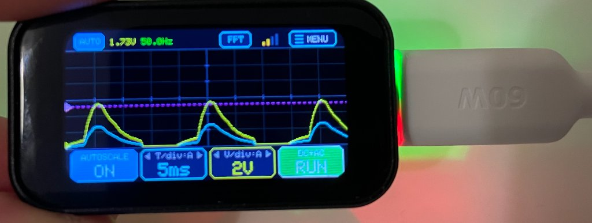 | 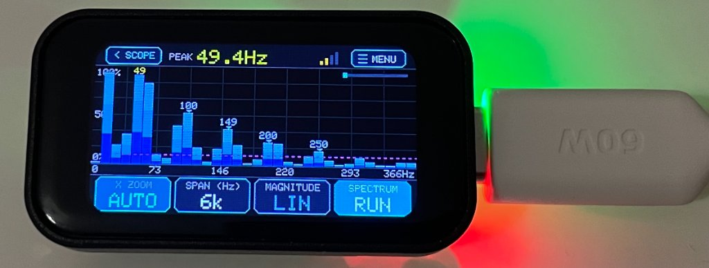 |
| *Dual-channel capture ($50\text{ Hz}$ sine wave, $1.73\text{ V}$, $5\text{ ms/div}$, $2\text{ V/div}$)* | *Real-time 128-bin FFT histogram locking onto fundamental peak at $49.4\text{ Hz}$* |

| Scope Configuration Menu | System Diagnostics & Settings | Idle Scope Baseline |
|:---:|:---:|:---:|
| 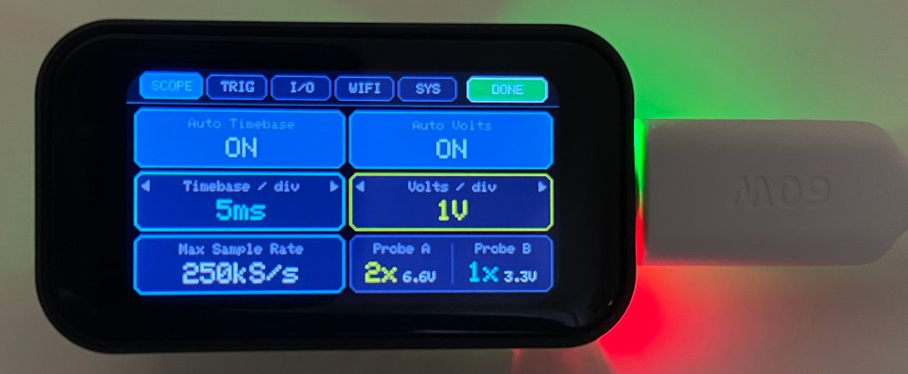 | 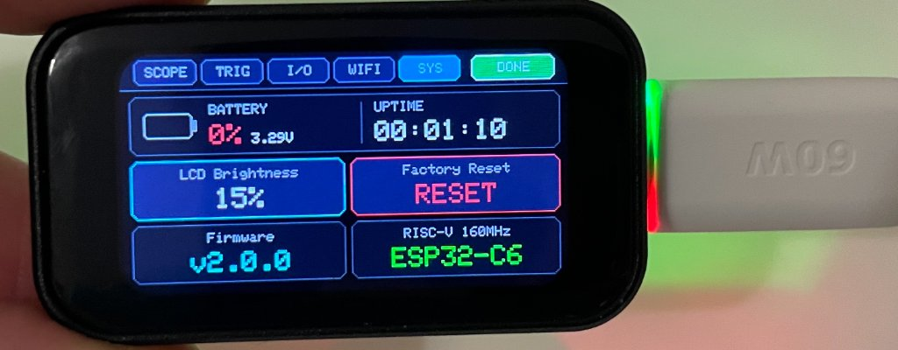 | 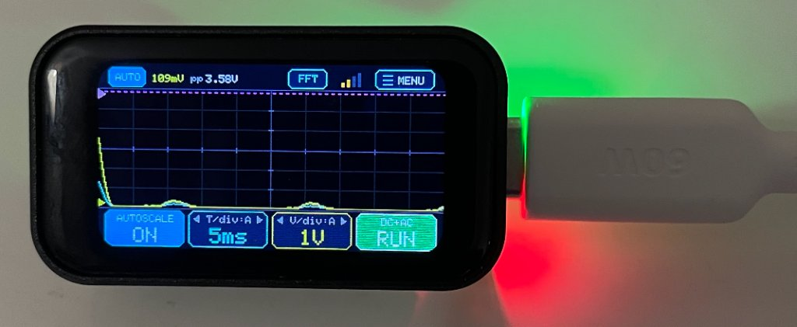 |
| *`[SCOPE]` tab: Auto Timebase, Auto Volts, Sample Rate & Probes* | *`[SYS]` tab: Battery SoC, Uptime, Brightness, Firmware & MCU info* | *Clean baseline reticle with top telemetry and touch controls* |

---

## 1. Key Features

- **Hardware Platform**: Built specifically for the **[Waveshare ESP32‑C6‑Touch‑LCD‑1.47‑M](https://docs.waveshare.com/ESP32-C6-Touch-LCD-1.47)** (RISC-V 160 MHz, 512 KB SRAM, 8 MB Flash).
- **Dual-Channel Architecture**:
  - **Probe A (CH1)**: Optimized for sub-$5.5\text{ V}$ signals with default **$2\times$ Divider ($0 \dots 6.6\text{ V}$)** yielding **$1.6\text{ mV}$ LSB resolution** (ideal for 3.3V/5V logic and low-voltage ripple).
  - **Probe B (CH2)**: Safe for $12\text{ V}$ power supplies with default **$4\times$ Divider ($0 \dots 13.2\text{ V}$)** yielding **$3.2\text{ mV}$ LSB resolution** (or digital logic analyzer `[D1]`).
- **Touchscreen Ergonomics**:
  - Oversized $74 \times 34\text{ px}$ tactile buttons along the bottom edge for easy thumb tapping.
  - Direct vertical finger-drag anywhere inside the waveform area to position the trigger threshold ($T$) smoothly.
  - One-tap top bar badge `[FFT]` switches instantly between time-domain scope and frequency spectrum analyzer.
- **Standalone FFT Spectrum Analyzer**:
  - 256-point Cooley-Tukey Radix-2 FFT with Hann windowing for minimal spectral leakage.
  - Electric blue gradient histogram with pill-shaped rounded caps and automated peak frequency marker (`PEAK xx.x Hz`).
  - Selectable horizontal zoom (`AUTO` peak-fit, `FULL` 0..Nyquist, `2x`, `4x`, `8x`) and vertical magnitude scale (Logarithmic $\text{dB}$ or Linear).
- **Built-in Calibration Signal Generator**:
  - Dedicated square-wave output on **`GPIO7`** selectable between `1 kHz`, `10 kHz`, `50 kHz`, or `OFF` ($3.3\text{ Vpp}$).
  - Zero-wire internal loopback self-test mode for instant diagnostics without any jumper wires.
- **Responsive Wi-Fi Web UI**:
  - Non-blocking boot sequence (boots standalone in 8 seconds if Wi-Fi is offline).
  - 25+ FPS real-time WebSocket push stream (`/ws`) with CRT phosphor glow canvas.
  - Interactive draggable time ($X_1, X_2 \rightarrow \Delta T, f$) and voltage ($Y_1, Y_2 \rightarrow \Delta V$) cursors.
  - 1-Click CSV export of 320-point capture buffers directly to PC or phone.
  - Complete REST API for automated telemetry extraction and remote parameter tuning.

---

## 2. Hardware Architecture & Pin Mapping

On the Waveshare board, several ESP32-C6 pins are routed internally to display and touch peripherals. PocketDSO uses dedicated, conflict-free pins for all external connections:

| Pin | Subsystem | Function | Signal Specification |
|:---|:---|:---|:---|
| **`GPIO6`** | **Probe A (CH1)** | Analog Input 1 (`ADC1_CH6`) | $0 \dots 6.6\text{ V}$ with $2\times$ divider ($1.6\text{ mV}$ resolution) |
| **`GPIO5`** | **Probe B (CH2)** | Analog Input 2 (`ADC1_CH5`) or Digital D1 | $0 \dots 13.2\text{ V}$ with $4\times$ divider ($3.2\text{ mV}$ resolution) |
| **`GPIO7`** | **Cal Out** | Built-in Test Signal Generator | $3.3\text{ Vpp}$ square wave (`1 kHz`, `10 kHz`, `50 kHz`) |
| **`GPIO0`** | **Battery Monitor** | Onboard Factory 3:1 Divider (`BAT_ADC`) | $3.3 \dots 4.2\text{ V}$ LiPo battery level and USB detection |
| **`GPIO1`** | Internal | `LCD_SCK` (SPI Clock) | **Do not connect externally** (driven at 40 MHz) |
| **`GPIO2`** | Internal | `LCD_MOSI` (SPI Data) | **Do not connect externally** |
| **`GPIO14`** | Internal | `LCD_CS` (Chip Select) | Hardware SPI control |
| **`GPIO15`** | Internal | `LCD_DC` (Data/Command) | Hardware SPI control |
| **`GPIO22`** | Internal | `LCD_RST` (LCD Reset) | Hardware display reset |
| **`GPIO23`** | Internal | `LCD_BL` (Backlight PWM) | 4-step brightness control ($15\%, 40\%, 70\%, 100\%$) |
| **`GPIO4`** | Internal | `TF_CS` (TF Card Chip Select) | Pulled `HIGH` on boot to prevent SPI bus conflict |
| **`GPIO18`** | Internal | `TOUCH_SDA` (I²C Data) | `AXS5106L` capacitive touch controller (`0x63`) |
| **`GPIO19`** | Internal | `TOUCH_SCL` (I²C Clock) | `AXS5106L` capacitive touch controller (`0x63`) |
| **`GPIO20`** | Internal | `TOUCH_RST` (Touch Reset) | Touch reset line |
| **`GPIO21`** | Internal | `TOUCH_INT` (Touch Interrupt) | Touch interrupt line |

---

## 3. Wiring Diagram & Electronics Bill of Materials (BOM)

To build the dual-channel probes safely and accurately, refer to the electronics schematic below:

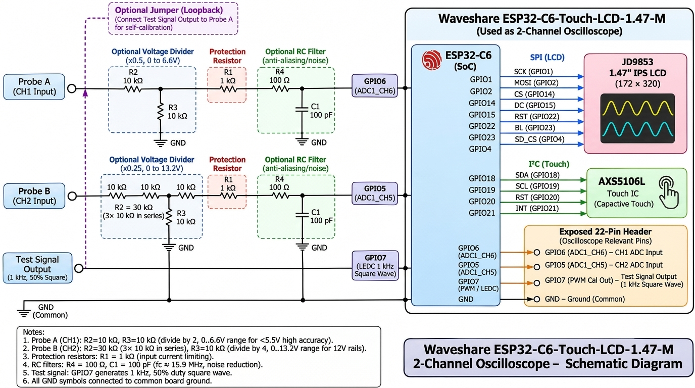

### 3.1 Required Components List

| Qty | Component | Value / Rating | Role in Circuit | Status |
|:---:|:---|:---|:---|:---:|
| **1×** | **Waveshare ESP32‑C6‑Touch‑LCD‑1.47‑M** | Waveshare SKU 31201 | MCU + 1.47" IPS LCD + Touch + Battery Charger | **Required** |
| **6×** | **Divider Resistors** | **$10\text{ k}\Omega$**, ¼ W (1% metal-film) | $2\times$ divider on CH1 ($2\times 10\text{ k}\Omega$), $4\times$ divider on CH2 ($3\times 10\text{ k}\Omega$ series $+ 1\times 10\text{ k}\Omega$) | **Required** |
| **2×** | **Protection Resistors ($R_1$)** | **$1\text{ k}\Omega$**, ¼ W (1%) | Current limiting into `GPIO6` (CH1) and `GPIO5` (CH2) | **Mandatory** |
| **2×** | **Filter Resistors ($R_4$)** | **$100\ \Omega$**, ¼ W | Anti-ringing RC filter resistor ($f_c \approx 16\text{ MHz}$) | Optional |
| **2×** | **Filter Capacitors ($C_1$)** | **$100\text{ pF}$** ceramic (50V) | Anti-aliasing / ringing damping capacitor to GND | Optional |
| **1 pk** | **DuPont Jumper Wires** | Female-to-Female & Female-to-Male | Board header to breadboard wiring | **Required** |
| **2×** | **Alligator Grabber Leads** | Mini IC grabber clips | Signal and Ground circuit connections | Recommended |
| **1×** | **Mini Breadboard** | 170-point or 400-point | Mounting the resistor divider network | Recommended |
| **1×** | **USB Type-C Cable** | Data + Power | Firmware upload and 5V power supply | **Required** |
| **1×** | **$3.7\text{ V}$ LiPo Battery** | 500–1000 mAh with **MX1.25 2-pin connector** | Cordless pocket instrument operation | Optional |

### 3.2 Probe Circuit Schematics

#### Probe A (CH1) — High-Accuracy $2\times$ Divider ($0 \dots 6.6\text{ V}$)
```text
  [Probe A Tip] ─── [R2: 10 kΩ] ───┬─── [R1: 1 kΩ] ───┬─── [R4: 100 Ω] ───► GPIO6 (ADC1_CH6 / CH1)
                                   │                  │
                            [R3: 10 kΩ]          [C1: 100 pF] (Optional RC filter)
                                   │                  │
  [GND Clip]    ───────────────────┴──────────────────┴───────────────────► GND   (Board Ground)
```

#### Probe B (CH2) — 12V Power Rails $4\times$ Divider ($0 \dots 13.2\text{ V}$)
```text
  [Probe B Tip] ── [R2: 30 kΩ (three 10 kΩ in series)] ──┬── [R1: 1 kΩ] ──┬── [R4: 100 Ω] ──► GPIO5 (ADC1_CH5 / CH2)
                                                         │                │
                                                   [R3: 10 kΩ]       [C1: 100 pF] (Optional RC filter)
                                                         │                │
  [GND Clip]    ─────────────────────────────────────────┴────────────────┴─────────────────► GND   (Board Ground)
```

---

## 4. UI Geometry & Ergonomic Layout

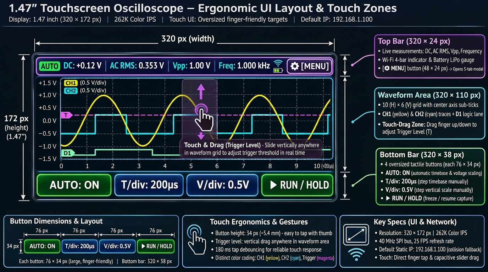

Operating an oscilloscope on a **1.47‑inch screen** (`320 × 172 px` active area, $\approx 35 \times 19\text{ mm}$) requires ergonomic layout design:
1. **Top Telemetry Bar (`320 × 24 px`)**:
   - `[AUTO]` badge: Toggles automatic horizontal and vertical signal prescaling.
   - Numerical Readouts: Average DC voltage ($V_{\text{DC}}$), True AC RMS ripple ($V_{\text{RMS,AC}} = \sqrt{\frac{1}{N}\sum(v_i - V_{\text{DC}})^2}$), Peak-to-Peak ($V_{\text{pp}}$), and Fundamental Frequency (`Hz`/`kHz`).
   - `[FFT]` badge: One-tap toggle to jump to the standalone FFT frequency spectrum analyzer.
   - Wi-Fi signal indicator: 4-bar RSSI gauge (tapping opens network diagnostics).
   - Battery meter: Percentage ($0 \dots 100\%$) and live voltage or `USB` indicator.
   - `[⚙ MENU]` button: Opens the full-screen 5-tab settings modal.
2. **Waveform Reticle & Touch Trigger (`320 × 110 px`)**:
   - Standard $10 \times 6$ grid divisions with sub-division tick marks along the center axes.
   - Direct Touch-Drag: Slide your thumb vertically on the grid to position the magenta trigger threshold line ($T$).
3. **Bottom Control Bar (`320 × 38 px`)**:
   - Four oversized rounded buttons ($74 \times 34\text{ px}$): `AUTO SCALE`, `T / div`, `V / div`, and `> RUN` / `|| HOLD`.

---

## 5. Software Screen Reference Gallery

| Main Scope View (`01_scope_main.png`) | Mixed-Signal MSO Mode (`03_scope_mso_hold.png`) |
|:---:|:---:|
| 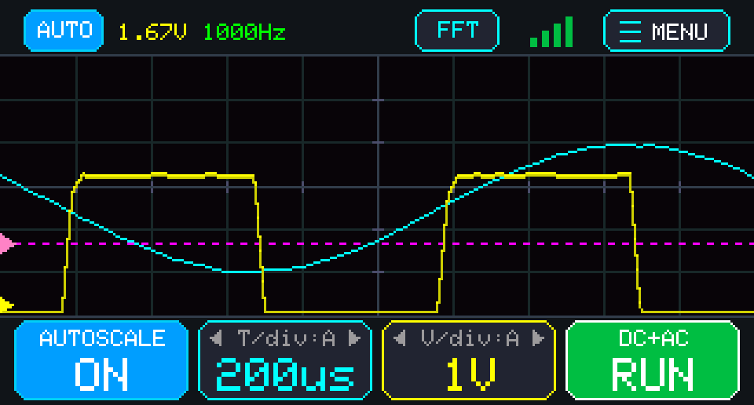 | 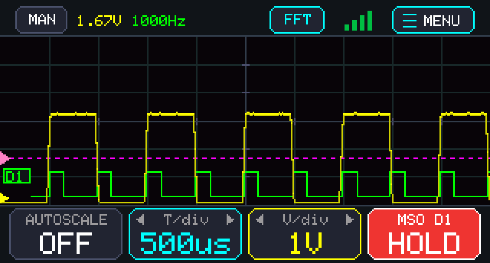 |
| *Active scope trace with neon yellow glow and telemetry* | *Mixed-signal view with Channel 2 Digital Logic Analyzer `[D1]`* |

| FFT Auto-Zoom (`04_fft_auto_zoom.png`) | FFT Full Span (`05_fft_full.png`) |
|:---:|:---:|
| 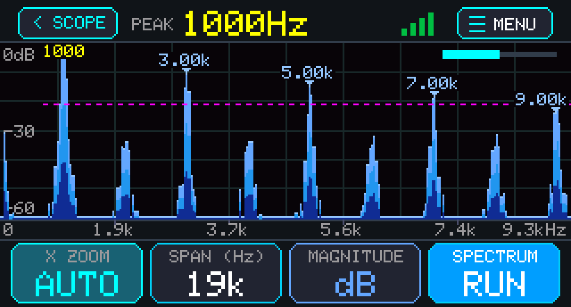 | 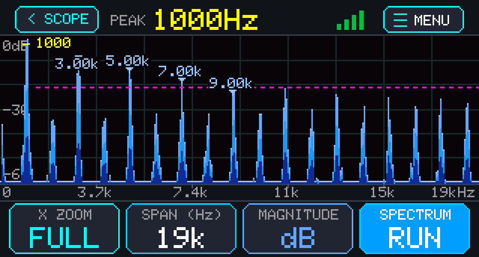 |
| *128-bin FFT with Auto Zoom centered on dominant peak* | *Full Nyquist span ($0 \dots 50\text{ kHz}$) frequency spectrum* |

| Menu: Scope Settings (`07_menu_scope.png`) | Menu: Trigger Settings (`08_menu_trig.png`) |
|:---:|:---:|
| 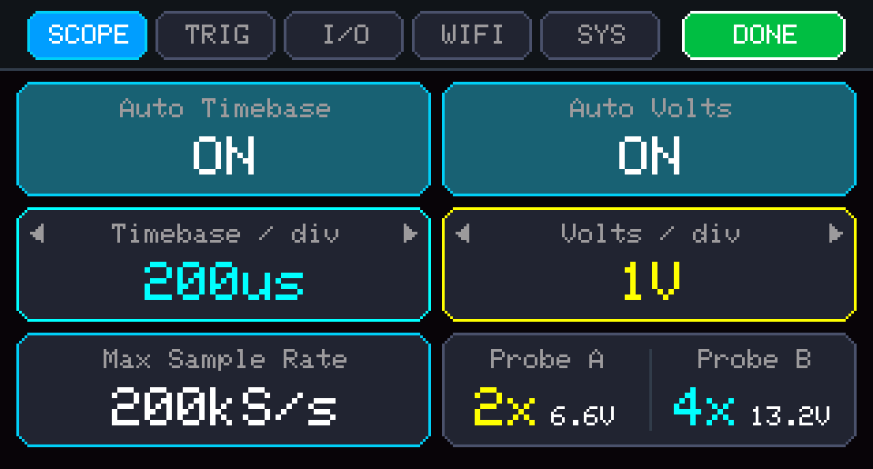 | 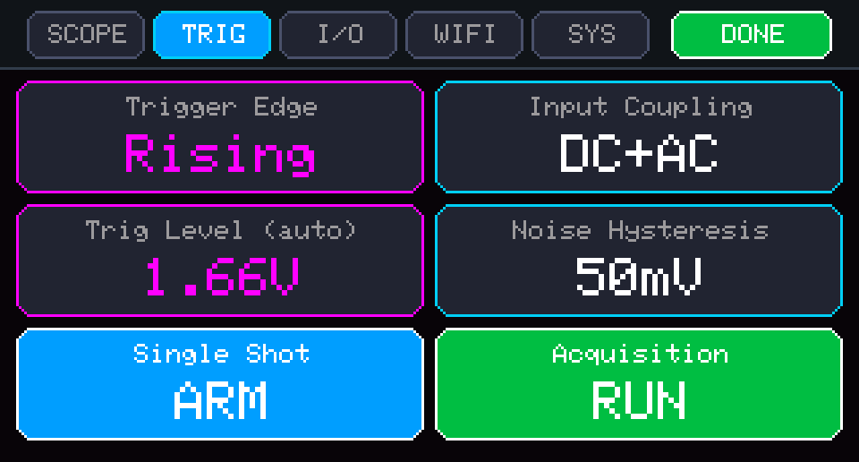 |
| *Timebase, volts/div, sample rate, and probe dividers* | *Trigger slope (Rising/Falling/Single), threshold & hysteresis* |

| Menu: Wi-Fi Diagnostics (`10_menu_wifi.png`) | Menu: System & MCU (`11_menu_sys.png`) |
|:---:|:---:|
| 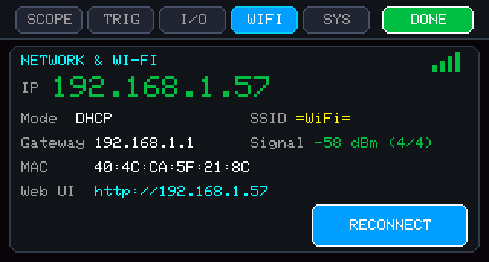 | 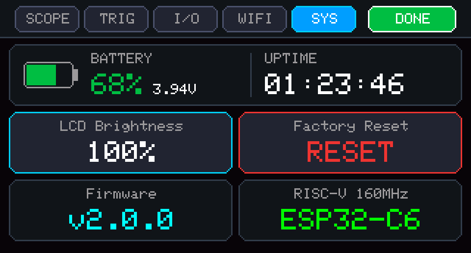 |
| *Connected IP, SSID, RSSI dBm, Subnet, MAC & WebSocket status* | *Battery level, Uptime, Brightness, Firmware & Factory Reset* |

---

## 6. Installation & Firmware Flashing

### Option A: Using PlatformIO (Recommended One-Click CLI)

PocketDSO comes configured with a ready-to-use [`platformio.ini`](platformio.ini) pointing to the firmware inside `oscilloscope/`.

1. Install **[VS Code](https://code.visualstudio.com/)** and the **[PlatformIO IDE extension](https://platformio.org/install/ide?install=vscode)** (or use PlatformIO Core CLI).
2. Clone this repository and open the workspace folder:
   ```bash
   git clone https://github.com/MoisisV/PocketDSO.git
   cd PocketDSO
   ```
3. Connect the Waveshare ESP32-C6 board to your computer via USB-C.
4. Build and flash the firmware:
   ```bash
   pio run -t upload
   ```
5. Open the Serial Monitor at 115200 baud to view network connection logs:
   ```bash
   pio device monitor -b 115200
   ```

> [!TIP]
> **Bootloader Recovery**: If the board does not automatically reset into flashing mode:
> 1. Press and hold the onboard **`BOOT`** button.
> 2. Press and release the **`RESET`** button once.
> 3. Release the **`BOOT`** button.
> 4. Run `pio run -t upload`. Once flashing completes, press **`RESET`** to boot PocketDSO.

---

### Option B: Using Arduino IDE (GUI)

1. Download and install **[Arduino IDE 2.3+](https://www.arduino.cc/en/software)**.
2. In **Settings / Preferences $\rightarrow$ Additional Boards Manager URLs**, paste:
   ```text
   https://espressif.github.io/arduino-esp32/package_esp32_index.json
   ```
3. Open **Boards Manager**, search for **`esp32`**, and install **`esp32` by Espressif Systems** (version **`3.0.5`** or newer).
4. Open **Library Manager** and install:
   - **`GFX Library for Arduino`** (by **Moon On Our Nation**, version **1.4.9** or newer).
   - *(Optional for Web UI)* **`ESP Async WebServer`** (by mathieucarbou) and **`AsyncTCP`**.
5. Configure the **Tools** menu settings:
   - **Board**: `ESP32 Arduino` $\rightarrow$ **`ESP32C6 Dev Module`**
   - **USB CDC On Boot**: **`Enabled`** *(Mandatory for Serial logs over USB-C)*
   - **Flash Size**: **`8MB (64Mb)`**
   - **Partition Scheme**: **`8M with spiffs (3MB APP/1.5MB SPIFFS)`** or **`Huge APP`**
   - **Upload Speed**: **`921600`**
6. Open [`oscilloscope/wifi_config.h`](oscilloscope/wifi_config.h) to configure your Wi-Fi SSID and password (or leave the defaults to boot in standalone offline mode).
7. Open [`oscilloscope/oscilloscope.ino`](oscilloscope/oscilloscope.ino) and click **Upload (`→`)**.

---

## 7. Web UI Remote Control & Real-Time Browser Dashboard

PocketDSO includes a fully self-contained, high-performance Web Application served directly from the ESP32-C6 Flash memory (`PROGMEM`). You do **not** need an internet connection, Node.js, or external cloud servers—the ESP32 acts as an embedded web server running right on your local Wi-Fi network.

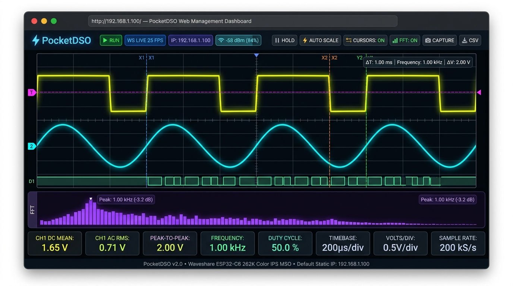

### 7.1 How to Connect & Open the Web UI

1. **Set your Wi-Fi Credentials**:
   Open [`oscilloscope/wifi_config.h`](oscilloscope/wifi_config.h) and enter your local Wi-Fi SSID and password:
   ```cpp
   #define WIFI_SSID     "YourNetworkName"
   #define WIFI_PASSWORD "YourSecretPassword"
   ```
   *(If left as `"WIFI_SSID"`, PocketDSO starts in standalone offline mode with zero delay).*

2. **Power On & Obtain IP Address**:
   - On boot, the ESP32-C6 connects to your Wi-Fi network within 3–5 seconds.
   - An **8-second non-blocking safety timeout** ensures that if Wi-Fi is disconnected or out of range, the physical LCD display boots immediately into standalone mode without hanging.
   - Once connected, the assigned IP address is clearly shown on the physical LCD screen (and in the `[WIFI]` settings tab).

3. **Open the Dashboard in your Browser**:
   Open any modern web browser on your computer, tablet, or smartphone (Chrome, Safari, Firefox, Edge) and navigate to:
   ```text
   http://<ESP32_IP_ADDRESS>
   ```
   Or on devices that support mDNS / Bonjour (macOS, iOS, Windows, Linux):
   ```text
   http://pocketdso.local
   ```

---

### 7.2 Web UI Features & How to Handle the Device

The Web UI transforms your computer or tablet into a full-size lab oscilloscope display while keeping bidirectional sync with the physical ESP32 device:

1. **Live High-FPS Waveform Display**:
   - **HTML5 `<canvas>` with CRT Phosphor Glow**: Renders dual analog traces (CH1 in neon yellow, CH2 in cyan) and the digital logic analyzer lane (`[D1]` in mint green) at 25+ FPS.
   - **Real-Time Telemetry Cards**: Live readouts display **CH1 DC Mean**, **CH1 AC RMS**, **CH1 Peak-to-Peak ($V_{\text{pp}}$)**, **Frequency (Hz)**, **Timebase**, **Volts/div**, **Trigger Voltage**, and **Achieved Sample Rate ($f_s$)**.

2. **Full Remote Control & Device Handling**:
   - **`▶ RUN` / `⏸ HOLD`**: Instantly freeze waveform acquisition from your browser to inspect transient glitches.
   - **`⚡ AUTO` Scale**: Triggers automated signal prescaling for both voltage and timebase.
   - **Horizontal & Vertical Controls**: Change horizontal Timebase ($20\,\mu\text{s/div} \dots 50\,\text{ms/div}$) and vertical Volts/div ($0.1\text{ V/div} \dots 2.0\text{ V/div}$) directly using on-screen buttons and drop-down selectors.
   - **Trigger Controls**: Switch trigger slopes (`Rising Edge /`, `Falling Edge \`, `Free Run`, `Single Shot !`), adjust trigger hysteresis, and click-drag the magenta trigger indicator (`T`) on the canvas.
   - **Channel 2 Mode**: Switch between `Analog CH2`, `Digital Logic D1`, or `OFF`.
   - **Calibration Generator**: Toggle the onboard square-wave generator on `GPIO7` (`1 kHz`, `10 kHz`, `50 kHz`, or `OFF`).
   - **Zero-Wire Loopback**: Toggle the internal software signal generator for testing without physical probes.

3. **Interactive On-Screen Measurement Cursors (`📏 Cursors: ON`)**:
   - Tap **`Cursors: ON`** to overlay interactive time and voltage crosshairs on the graph:
     - **Time Cursors ($X_1, X_2$)**: Drag the blue and orange vertical lines to measure time intervals ($\Delta T$) and automatically calculate frequency ($f = \frac{1}{\Delta T}$).
     - **Voltage Cursors ($Y_1, Y_2$)**: Drag the green and purple horizontal lines to measure differential voltage ($\Delta V$).

4. **In-Browser FFT Spectrum Analyzer (`📊 FFT: ON`)**:
   - Tap **`FFT: ON`** to open an integrated 128-bin frequency spectrum analyzer below the main time-domain waveform.
   - Automatically tracks dominant harmonic peaks and fundamental frequencies in real time.

5. **1-Click Raw CSV Data Export (`📥 CSV`)**:
   - Click the **`📥 CSV`** button in the top navigation bar to download all 320 capture data points directly to your computer as a `.csv` spreadsheet file (time in microseconds, CH1 voltage, CH2 voltage).
   - No Python scripts or terminal commands required!

6. **1-Click High-Res PNG Capture (`📷 Capture`)**:
   - Click **`📷 Capture`** to save an instant PNG screenshot of the live scope graph complete with reticle, traces, and timestamp.

7. **Wi-Fi Diagnostics Modal (`⚙ Wi-Fi`)**:
   - Click the Wi-Fi badge to open a live diagnostics popup displaying RSSI signal strength ($\text{dBm}$), Gateway, Subnet, MAC address, and active WebSocket client count.

---

### 7.3 Web REST API Reference

| Endpoint | Method | Description |
|:---|:---:|:---|
| `/` | `GET` | Responsive dark-mode HTML5/Canvas dashboard (served from Flash `PROGMEM`) |
| `/ws` | `WebSocket` | Real-time push stream of 320-point waveform buffers and live telemetry |
| `/api/metrics` | `GET` | Returns JSON telemetry (`dc`, `ac`, `vpp`, `freq`, `ch2Mode`, `selfTest`, `timeBaseStr`, `vDivStr`, `batVolts`, `batPct`) |
| `/api/waveform` | `GET` | Returns high-resolution 320-point JSON array for CH1 and CH2 |
| `/api/set` | `GET` | Updates parameters: `autoTimebase=0\|1`, `autoVolts=0\|1`, `timeBaseIdx=0..10`, `vDivIdx=0..4`, `running=0\|1`, `acCoupled=0\|1`, `ch2Mode=0\|1\|2`, `trigMode=0..3`, `calFreqIdx=0..3` |

---

## 8. First-Run Loopback Self-Test

You can verify the entire analog front-end and firmware in 60 seconds without external equipment:

### Method A: Zero-Wire Internal Self-Test
1. Power PocketDSO via USB-C.
2. Tap **`[⚙ MENU]`** $\rightarrow$ tap the **`[I/O]`** tab.
3. Tap **`Signal Source`** until it displays **`0-Wire Loopback`**.
4. Tap **`DONE`**. The screen immediately locks onto the synthesized $1.00\text{ kHz}, 3.3\text{ Vpp}$ square wave with top bar displaying `[LOOP]`.

### Method B: Physical Hardware Loopback
1. Connect a DuPont jumper wire directly between **`GPIO7` (Cal Output)** and **`GPIO6` (CH1 Probe A)**.
2. **Result**:
   - The screen locks onto the built-in $1.00\text{ kHz}, 3.3\text{ Vpp}$ square wave.
   - Telemetry displays: **`DC: 1.65V`**, **`AC: 1.65V`**, **`1.0kHz`**.
   - The reticle prescales automatically to **$500\,\mu\text{s/div}$** and **$1.0\text{ V/div}$**.
   - Tap **`[FFT]`** to view the fundamental frequency bar at $1.0\text{ kHz}$ along with odd harmonic peaks ($3\text{ kHz}, 5\text{ kHz}$).

---

## 9. Project File Structure

```text
PocketDSO/
├── .gitignore                      # Git exclusion rules (ignores sim/, backup, build artifacts)
├── LICENSE                         # MIT Open Source License (Moisis Vafeiadis <moisisv@gmail.com>)
├── DISCLAIMER.md                   # Detailed legal and hardware accuracy disclaimer
├── README.md                       # Comprehensive project documentation and guides
├── platformio.ini                  # PlatformIO configuration pointing to oscilloscope/
├── electronics_schematic.png       # Complete hardware schematic and probe divider circuits
├── ui_finger_friendly.png          # UI geometry and touch-zone ergonomic reference
├── oscilloscope/                   # Firmware source directory
│   ├── oscilloscope.ino            # Main firmware (JD9853 LCD driver, AXS5106L Touch, WebUI server)
│   ├── dso_core.h                  # Header-only core DSP (FFT, Auto-Scale, Metrics, Hit-Testing, NVS)
│   └── wifi_config.h               # Wi-Fi SSID, password, DHCP, and static IP configuration
├── images/                         # Project visual assets
│   ├── hardware/                   # High-resolution photos of real physical hardware
│   │   ├── real_scope_signal.jpg   # Dual-channel 50Hz signal running on physical board
│   │   ├── real_scope_idle.jpg     # Baseline idle screen on physical board
│   │   ├── real_fft_spectrum.jpg   # 128-bin FFT spectrum running on physical board
│   │   ├── real_menu_scope.jpg     # SCOPE settings menu on physical board
│   │   └── real_menu_sys.jpg       # SYS diagnostics menu on physical board
│   └── screens/                    # High-resolution software UI screen renders
│       ├── 01_scope_main.png       # Main oscilloscope display
│       ├── 02_scope_loopback_offline.png # 0-Wire loopback offline display
│       ├── 03_scope_mso_hold.png   # Mixed-signal analog + logic analyzer trace
│       ├── 04_fft_auto_zoom.png    # FFT frequency spectrum with Auto-Zoom
│       ├── 05_fft_full.png         # FFT frequency spectrum full Nyquist span
│       ├── 06_fft_8x_linear.png    # FFT spectrum 8x linear magnitude
│       ├── 07_menu_scope.png       # Settings modal: SCOPE tab
│       ├── 08_menu_trig.png        # Settings modal: TRIG tab
│       ├── 09_menu_io.png          # Settings modal: I/O tab
│       ├── 10_menu_wifi.png        # Settings modal: WIFI tab
│       ├── 11_menu_sys.png         # Settings modal: SYS tab
│       └── 12_menu_sys_usb_reset_armed.png # Settings modal: Factory reset confirmation
├── test/                           # Unit test and simulation harness
│   ├── test_core.cpp               # C++ native test suite (Sine, Square, FFT, Touch, NVS)
│   ├── test_web_server.js          # Node.js mock HTTP and WebSocket server for Web UI testing
│   └── web_ui_test.html            # Standalone Web UI testing canvas
└── doc/
    └── SW/
        └── README.md               # In-depth software and DSP architectural documentation
```

> **Note on Simulator**: The `sim/` directory is used for local desktop simulation development and is excluded from the published git repository via `.gitignore`.

---

## 10. Running Unit Tests

PocketDSO includes a native C++ test suite (`test/test_core.cpp`) that verifies the DSP pipeline, FFT accuracy, auto-scale algorithms, settings serialization, and touch hit-testing without needing physical hardware:

```bash
# Compile and run native C++ tests
clang++ -std=c++17 test/test_core.cpp -o test/test_core
./test/test_core
```

To preview and test the Web UI locally on your computer:
```bash
# Start the local mock Web UI test server
node test/test_web_server.js
# Open http://localhost:8080 in your browser
```

---

## 11. License & Contributing

- **License**: Released under the **[MIT License](LICENSE)**. Copyright (c) 2026 Moisis Vafeiadis `<moisisv@gmail.com>`. Free to use, modify, distribute, and integrate into personal, educational, or commercial projects.
- **Contributing**: Bug reports, pull requests, and feature suggestions are welcome! Please ensure all native unit tests pass (`test/test_core.cpp`) before submitting pull requests.
