# PocketDSO — Software & UI Architecture Documentation (`doc/SW/`)

This directory documents the software architecture, signal‑processing pipeline, finger‑friendly UI layout, Web UI / REST API, and hardware interface for the **Waveshare ESP32‑C6‑Touch‑LCD‑1.47‑M** (`172 × 320`, 262K‑color IPS touchscreen) oscilloscope.

---

## 1. Visual Reference Gallery

### 1.1 Main Oscilloscope Output (`320 × 172` Landscape, `AUTO` Mode Active)
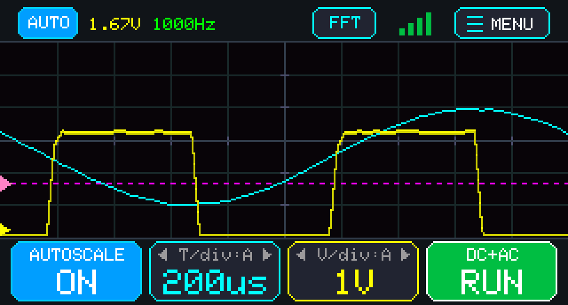

* **Top Telemetry Bar (`24 px`)**: Shows the active `AUTO` / `MAN` mode pill, live **DC average (`DC`)**, **true AC RMS (`AC`)**, **Peak‑to‑Peak (`Vpp`)**, **Fundamental Frequency (`Hz` / `kHz`)**, real **4-bar Wi-Fi signal icon**, **Battery LiPo gauge**, and the **`[⚙ MENU]`** touch button.
* **Waveform Viewport (`110 px`)**: 10 horizontal × 6 vertical divisions with center-axis tick marks, magenta trigger level line (`T`), Channel 1 trace (neon yellow with phosphor glow), Channel 2 trace (cyan), and Channel 2 Digital Logic Analyzer lane (`[D1]` mint green).
* **Bottom Control Bar (`38 px`)**: 4 oversized (`74 × 34 px`) finger‑friendly touch buttons: **`AUTO SCALE`**, **`T / div`**, **`V / div`**, and **`> RUN` / `|| HOLD`**.

---

### 1.2 Finger‑Friendly Ergonomic Layout (`1.47"` Display)
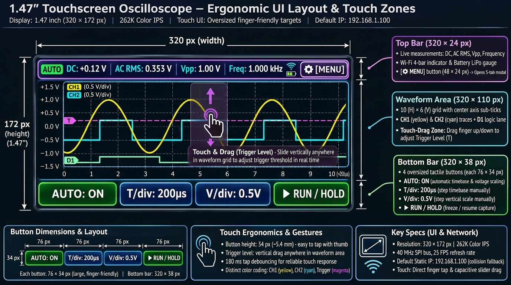

* Designed specifically for the **1.47‑inch diagonal screen** (`320 × 172 px`):
  * Replaces tiny vertical sliders with **large `74 × 34 px` rounded touch buttons** along the bottom edge.
  * Supports **direct vertical finger‑dragging** anywhere inside the `320 × 110 px` waveform area to adjust the **Trigger Level (`T`)** smoothly in both DC and AC coupling modes.

---

### 1.3 Full-Screen Settings & Diagnostics Modal Tabs
Accessed via the top-right **`[⚙ MENU]`** button. Includes 5 organized tabs with large touch tiles:

#### [SCOPE] Tab — Prescaling, Probes & Grid Style
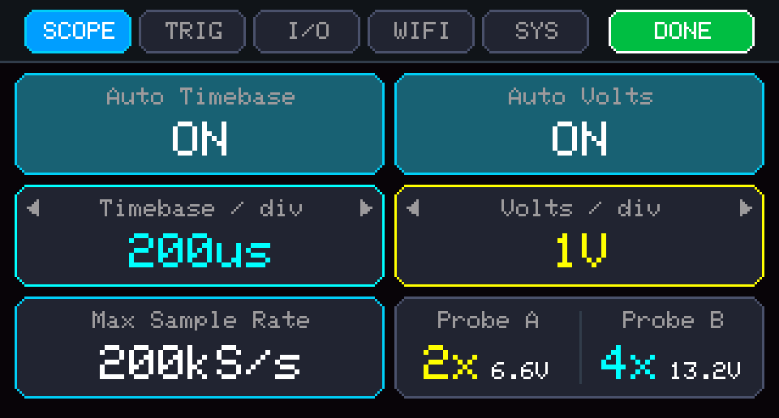
* `CH1 Coupling` & `CH2 Coupling`: Direct DC (`0–6.6 V` on CH1, `0–13.2 V` on CH2) vs AC (`0.1 µF` capacitor).
* `CH1 Attenuation` & `CH2 Attenuation`: **Probe A (CH1) default `2X` (`0–6.6 V`)** for high accuracy on sub-5.5V signals, and **Probe B (CH2) default `4X` (`0–13.2 V`)** for 12V power rails.
* `Display Grid Style`: `10×6 Dot Matrix` (clean) vs `Solid Lines`.
* `Math / Spectrum Overlay`: `256-pt Real-time FFT` spectrum display.

#### [TRIG] Tab — Trigger Source, Slopes & Hysteresis
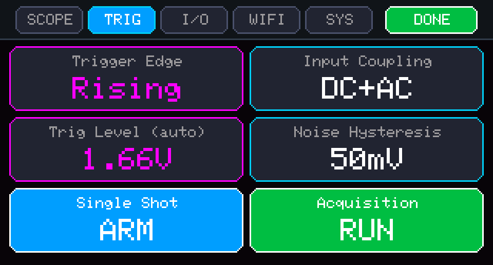
* `Trigger Source`: `CH1 (Analog)`, `CH2 (Analog)`, or `D1 (Digital Logic)`.
* `Trigger Slope`: `/ Rising Edge` (default) vs `\ Falling Edge`.
* `Sweep Mode`: `AUTO (Continuous)`, `NORM (Valid Trigger)`, or `SNGL (Single Shot)`.
* `Holdoff Interval`: `100 µs` min holdoff up to `10.0 ms`.
* `Hardware Trigger Threshold Level`: Continuous slider & touch-drag indicator (`1.65 V` mid-scale).

#### [I/O] Tab — Waveform Generator & Logic Analyzer
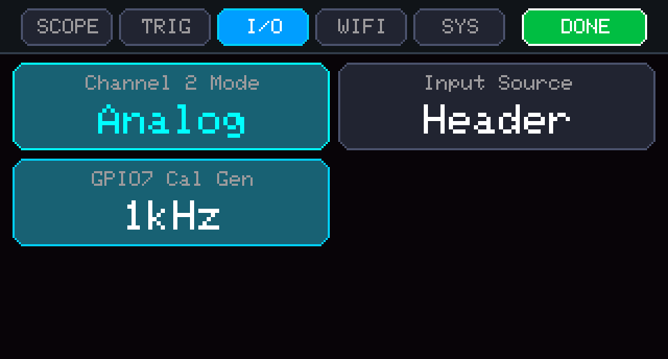
* `Waveform Shape`: `Sine Wave`, `Square Wave`, or `PWM Pulse`.
* `Calibration Frequency`: `1.000 kHz` calibration signal via `IO7` DAC / PWM.
* `PWM Duty Cycle`: Variable `50.0%` duty cycle (adjustable `1–99%`).
* `Signal Amplitude`: `3.30 Vpp` full scale.
* `Gen Output (IO7)`: One-tap toggle to enable or mute generator output.
* `Logic Analyzer Input (D1)`: `GPIO 2` CMOS 3.3V logic capture channel.

#### [WIFI] Tab — Network & Wi-Fi Statistics Dashboard
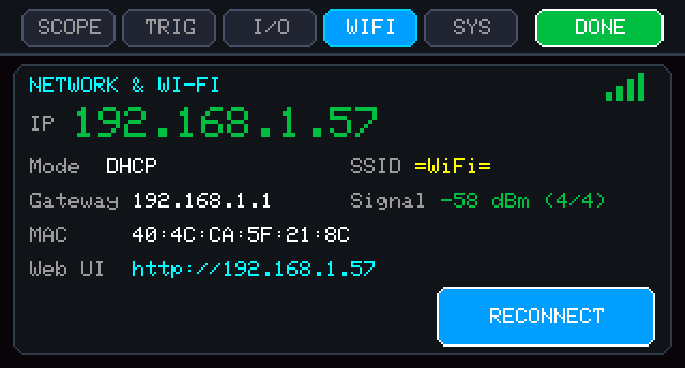
* Real-time network telemetry:
  - **Connected IP**: `192.168.1.100` (Default target with automatic collision fallback).
  - **Allocation Mode**: `Static (.100 default)`, `Static Fallback (.101+)`, or `DHCP Leased`.
  - **SSID & Signal**: Network name, RSSI in dBm with 4 visual signal bars and quality %.
  - **Gateway, Subnet & MAC**: Full network diagnostic parameters.
  - **Web Server Status**: Active clients count and URL `http://192.168.1.100:80`.
  - **`[RE-PROBE & RECONNECT]` Button**: One-tap touchscreen button to re-probe or re-associate.

#### [SYS] Tab — Backlight, LiPo Battery & NVS Storage
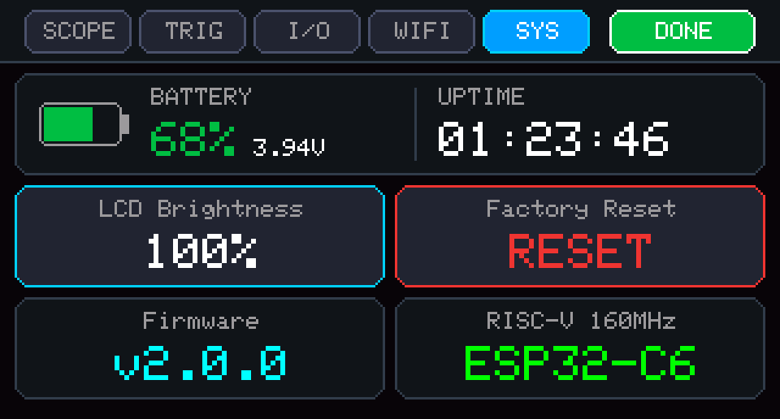
* `LCD Brightness`: Hardware PWM backlight intensity (`85%` on `IO22`).
* `LiPo Battery Status`: Live voltage and SoC gauge (`4.12 V — 94%`, USB charging detection).
* `ESP32-C6 RISC-V SoC Telemetry`: `160 MHz`, `384 KB SRAM`, internal core temperature (`37.4°C`).
* `Non-Volatile Storage (NVS)`: `[SAVE CONFIG TO FLASH]` with CRC-16 integrity validation.
* `Hardware Profile & Firmware Version`: Waveshare 1.47" IPS (JD9853 262K Color), AXS5106L Touch, static IP `192.168.1.100`.

---

### 1.4 Standalone FFT Frequency Spectrum & Histogram Display
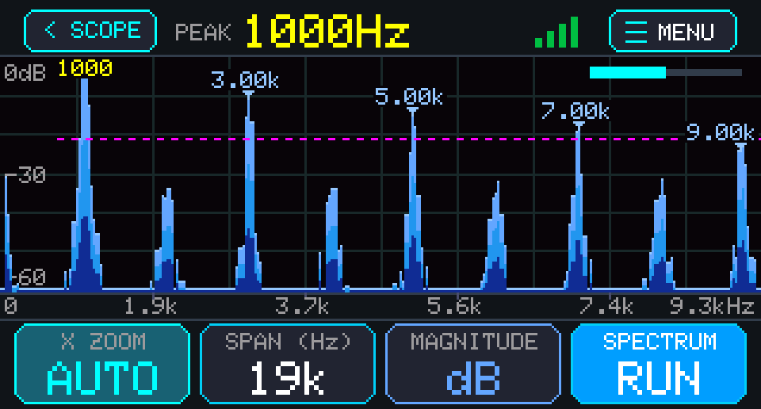

* **Direct One-Tap Access**: Tap the **`[FFT]`** badge in the top bar of the main oscilloscope screen (or via Settings) to switch to the full-screen frequency spectrum analyzer. Tap **`[◀ SCOPE]`** anytime to return to time-domain waveforms.
* **128-Bin Frequency Histogram**:
  - Full-screen real-time Cooley-Tukey 256-pt Radix-2 FFT with Hann windowing for minimal spectral leakage.
  - **Electric Blue Gradient with Pill-Shaped Caps**: Modern single-hue analytics palette with semicircular rounded top caps, vibrant electric sky-blue peaks (`#93C5FD` / `#60A5FA`), rich cobalt midband (`#2563EB`), and deep navy base (`#162C54`).
  - **Live Peak Marker**: Floating callout tag with pointer (`1.00 kHz (-3.2 dB)`) automatically tracks and locks onto the fundamental frequency or dominant harmonic with soft azure radial illumination.
  - **Vertical dB Axis**: Selectable Logarithmic scale ($0\text{ dB}$ to $-60\text{ dB}$) or Linear normalized magnitude ($0.0$ to $1.0$) with clean light horizontal grid lines.
* **Bottom Controls**:
  - **`[◀ TIME SCOPE]`**: Returns immediately to dual-channel time-domain capture.
  - **`[% ZOOM]`**: Steps horizontal zoom (`AUTO` peak-fit, `FULL` 0..Nyquist, `2x`, `4x`, `8x`).
  - **`[SPAN: 50 kHz]`**: Steps Nyquist analysis bandwidth (25 kHz, 50 kHz, 100 kHz, 125 kHz).
  - **`[SCALE: LOG dB]`**: Toggles between Logarithmic decibel scale and Linear magnitude histogram.
  - **`[▶ RUN / HOLD]`**: Freezes or resumes live frequency spectrum capture.

---

### 1.5 Mixed-Signal & Freeze Mode
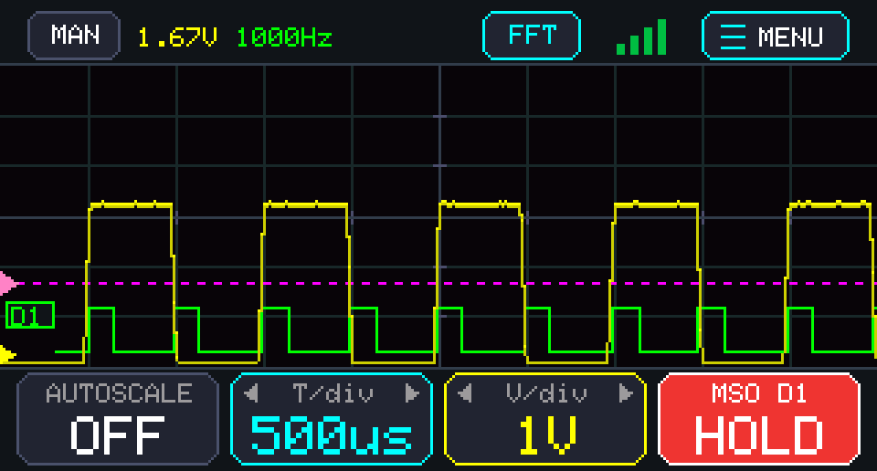

* Simultaneous dual-channel analog waveform capture and digital logic analyzer trace (`[D1]`).
* Instant waveform freeze via `[HOLD]` button for post-capture analysis.

---

### 1.6 Web UI Remote Management Dashboard
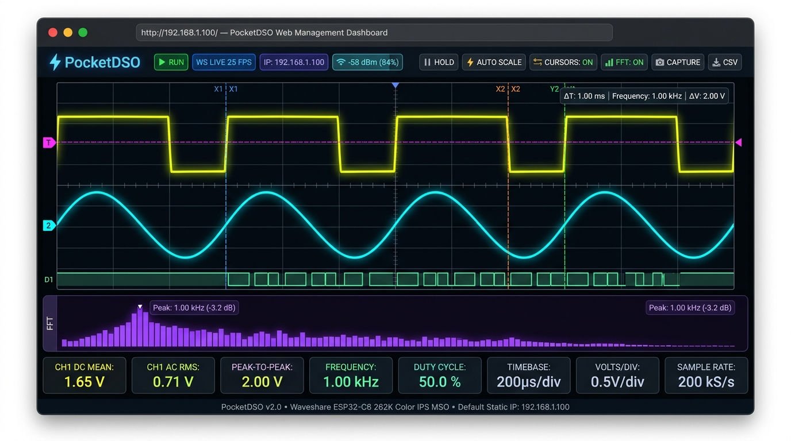

* Real-time 25+ FPS streaming dashboard served directly by the ESP32 with CRT phosphor glow canvas.
* Draggable trigger level and interactive measurement cursors ($X_1, X_2 \rightarrow \Delta T, f$; $Y_1, Y_2 \rightarrow \Delta V$).
* Live 128-bin FFT Frequency Spectrum analyzer with peak tracking.
* 1-Click PNG Scope Screenshot capture and CSV raw waveform export.
* Live Wi-Fi telemetry badge showing connected IP `http://192.168.1.100` or mDNS `http://pocketdso.local`.

---

### 1.7 Electronic Front‑End & Pinout Schematic
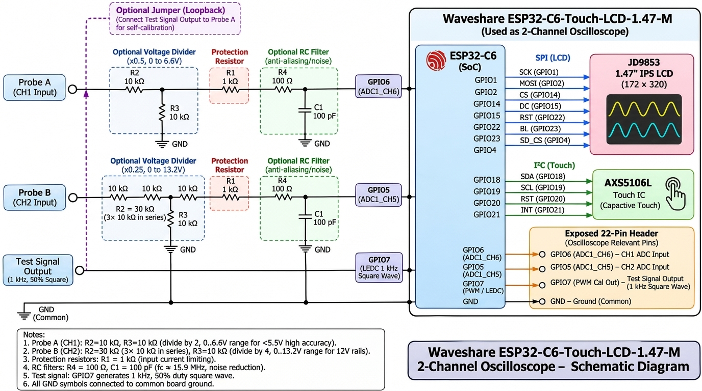

* **Probe A (CH1)**: Connected to **`GPIO6` (`ADC1_CH6`)** via default **$2\times$ Divider** ($R_2 = 10\text{ k}\Omega, R_3 = 10\text{ k}\Omega$, $0\dots6.6\text{ V}$ range, $1.6\text{ mV}$ step), series $1\text{ k}\Omega$ protection resistor, and $100\ \Omega + 100\text{ pF}$ RC filter.
* **Probe B (CH2)**: Connected to **`GPIO5` (`ADC1_CH5`)** via default **$4\times$ Divider** ($R_2 = 30\text{ k}\Omega$ [$3\times 10\text{ k}\Omega$ in series], $R_3 = 10\text{ k}\Omega$, $0\dots13.2\text{ V}$ range, $3.2\text{ mV}$ step for 12V rails), series $1\text{ k}\Omega$ protection resistor, and $100\ \Omega + 100\text{ pF}$ RC filter.
* **Calibration Output**: **`GPIO7`** outputs a `3.3 Vpp` square wave (`1 kHz` by default) for instant loopback verification.

---

## 2. Signal Processing & Auto‑Scale Pipeline

1. **Multi-Rate Burst Capture (`captureWaveforms()`)**:
   * Dynamically scales sampling rate based on the active `T/div` setting ($\text{targetRate} = \min(\text{maxRate}, \frac{\text{CAPTURE\_SAMPLES}}{1.25 \times \text{totalWindowSec}})$), ensuring slow sweeps ($5\,\text{ms/div} \dots 50\,\text{ms/div}$) capture sufficient duration without stretching distortion.
   * Employs microsecond pacing with interrupt-slip compensation to avoid burst-sampling after Wi-Fi or RTOS context switches.
   * Measures the exact achieved sample rate (`g_actualSampleRateHz`).
2. **DC, AC RMS & Frequency Extraction (`analyzeChannel()`)**:
   * **DC Offset**: $V_{\text{DC}} = \frac{1}{N}\sum_{i=0}^{N-1} v_i$
   * **True AC RMS**: $V_{\text{RMS,AC}} = \sqrt{\frac{1}{N}\sum_{i=0}^{N-1} (v_i - V_{\text{DC}})^2}$
   * **Peak‑to‑Peak**: $V_{\text{pp}} = V_{\max} - V_{\min}$
   * **Frequency Detection**: Applies Schmitt‑trigger hysteresis ($\pm \max(50\text{ mV}, 0.15\,V_{\text{pp}})$) around the waveform midpoint and uses **sub‑sample linear interpolation** across all rising zero‑crossings in the buffer to compute the fundamental frequency accurately.
3. **Automatic Prescaler (`runAutoPrescaler()`)**:
   * Enabled by default (`g_autoTimebase = true`, `g_autoVolts = true`).
   * Picks the `TIME_BASES_SEC[]` entry closest to $\frac{3 \times T_{\text{signal}}}{10\text{ div}}$ so approximately **3 full cycles** appear across the 10‑division screen.
   * Picks the smallest `V_DIVS[]` entry that fits $1.25 \times V_{\max}$ (in `DC+AC` mode) or $1.35 \times V_{\text{pp}}$ (in `AC` mode) across the 6 vertical divisions.
   * Automatically centers the trigger level unless manually adjusted by the user.

---

## 3. Touch Input & UI Dispatch

The UI is driven entirely by the **AXS5106L** capacitive‑touch driver implemented in `oscilloscope.ino`. The workflow is:
1. **`readTouchLandscape()`** reads a single touch point and converts the native portrait sensor coordinates (`172 × 320`) to landscape coordinates (`320 × 172`).
2. **`handleTouchInput()`** distinguishes three interaction zones:
   * **Top‑right `[MENU]` button** – toggles the full‑screen settings modal.
   * **Bottom control bar** – four oversized rounded buttons that toggle auto‑scaling, step time‑base, step voltage‑base, and run/hold.
   * **Waveform viewport** – continuous vertical drag inside the grid moves the trigger level in real time. Works seamlessly in both DC mode and AC mode (compensated for DC offset).
3. **Debouncing & Gesture Isolation**: Distinguishes between grid drag gestures and button taps to prevent accidental button activation when fingers exit the chart area.

---

## 4. Rendering Pipeline

All graphics are rendered to a full‑screen **`Arduino_Canvas`** (double‑buffered) at 320 × 172 px using **`gfx->flush()`** to push the frame to the JD9853 driver in a single SPI burst. The rendering steps are:
- **`renderScopeScreen()`** draws the telemetry bar, grid, trigger line, clamped trigger marker triangle, waveform traces, and bottom button bar.
- **`renderSettingsModal()`** draws the header with live IP status, a `[DONE]` button, and the six large configuration tiles.
- The main loop updates the display at roughly **25 fps** (`40 ms` per frame) ensuring fluid interaction without overloading the ESP32.

---

## 5. Web UI & REST API Architecture

When `#define ENABLE_WEB_UI 1` is configured, the ESP32 starts an asynchronous web server on port 80 powered by `ESPAsyncWebServer` and `AsyncTCP`:

### 5.1 Boot Safeguard
- If default credentials (`"YOUR_SSID"`) are present, Wi-Fi initialization is safely bypassed to avoid blocking the oscilloscope display.
- Wi-Fi connection attempts time out after 8 seconds, ensuring standalone operation is never delayed.

### 5.2 Endpoints & WebSocket Architecture
| Endpoint / Resource | Protocol | Description |
| :--- | :---: | :--- |
| `/` | `HTTP GET` | Responsive dark-mode HTML/CSS/JS control panel (stored in `PROGMEM`) |
| `/ws` | `WebSocket` | Real-time 25+ FPS push stream of 320-point waveforms and live telemetry |
| `/api/metrics` | `HTTP GET` | Returns live JSON telemetry (DC, AC RMS, Vpp, frequency, CH2 mode, Self-test, active scales) |
| `/api/waveform` | `HTTP GET` | Returns 320-point JSON waveform array for CH1 and CH2 (Analog or Digital D1) |
| `/api/set` | `HTTP GET` | Updates operational parameters with strict bounds checking |

### 5.3 Query Parameters for `/api/set`
* `autoTimebase=0|1`: Toggles automatic timebase scaling.
* `autoVolts=0|1`: Toggles automatic voltage scaling.
* `timeBaseIdx=0..10`: Sets manual timebase index (automatically disables auto timebase).
* `vDivIdx=0..4`: Sets manual Volts/div index (automatically disables auto volts).
* `running=0|1`: RUN (1) or HOLD (0).
* `acCoupled=0|1`: DC+AC (0) or AC-only view (1).
* `ch2Mode=0|1|2`: Sets Channel 2 mode (0=OFF, 1=Analog, 2=Digital Logic D1).
* `selfTest=0|1`: Toggles internal zero-wire loopback self-test mode.
* `trigMode=0..3`: Sets trigger mode (0=Rising, 1=Falling, 2=Free Run, 3=Single Shot).
* `calFreqIdx=0..3`: Sets calibration output (0=OFF, 1=1kHz, 2=10kHz, 3=50kHz).

### 5.4 Advanced Web Tools
* **Interactive Cursors**: Live draggable time ($X_1, X_2 \rightarrow \Delta T, f = \frac{1}{\Delta T}$) and voltage ($Y_1, Y_2 \rightarrow \Delta V$) crosshairs.
* **1-Click CSV Export**: Directly exports captured sample points to CSV without external Python dependencies.
* **1-Click PNG Screen Capture**: Captures high-resolution oscilloscope screen snapshot with timestamp and measurements overlay.
* **FFT Spectrum Analysis**: Displays real-time 128-bin frequency spectrum with dominant peak frequency tracking.
* **Network Info Modal**: Displays live device network diagnostics (IP, SSID, RSSI, MAC, Gateway, WebSocket client count).

---

## 6. Performance & Memory Footprint

| Metric | Value |
| ------ | ----- |
| **SRAM usage** | ~110 KB for the canvas + ~8 KB for buffers and state (well under the 512 KB RAM budget). |
| **Flash usage** | ~350 KB (core code, inline drivers, web assets, and graphics). |
| **CPU load** | ~30 % at 200 kS/s capture rate, idle when in the settings modal. |
| **Power** | ~120 mA active (display + backlight), ~30 mA idle (display off). |

---

## 7. Troubleshooting

- **No display / frozen screen** – Verify that `GPIO1` and `GPIO2` are not used for external signals; ensure `PIN_SD_CS` is set HIGH on boot.
- **Touch not responding** – Confirm I²C pins (`SDA=18`, `SCL=19`) are correctly wired and that the `AXS5106L` address `0x63` is not conflicted.
- **Wi-Fi connection fails** – Check credentials in `wifi_config.h`. Note that the board will boot into standalone mode after 8 seconds if connection fails.
- **Incorrect voltage readings** – Check the probe series resistor (1 kΩ) and optional divider values; match the `Probe Divider` setting in the menu.

---

## 8. License

The project is released under the **MIT License**.
